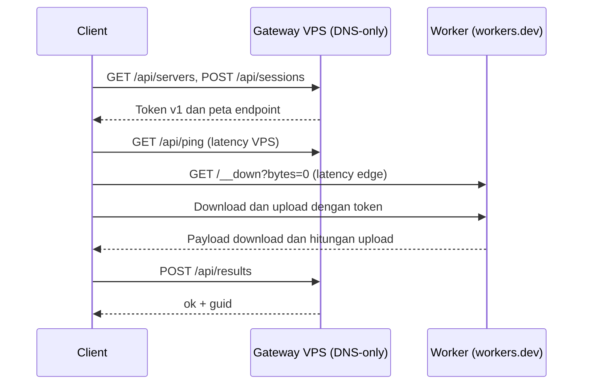

# SpeedtestServer dengan Cloudflare Workers Free

**Versi 2 — 24 November 2026.** Basis audit: `SpeedtestServer` `master@942b947` dan `SpeedtestHost-Tester` `main@eab1697`. [Repo server][repo-master] · [Repo tester][repo-tester]

Versi 1 (21 November 2026) mengaudit `master@8912b07`. Pada commit itu, `hybrid/` belum ada di `master`. Worker, gateway, dan probe client ditulis pada 6 November di branch `hybrid-vps-workers`, lalu baru di-merge ke `master` pada 23 November (`836f7de`). Perubahan versi 2:

- **§0 baru.** Status komponen, fakta VPS operator, dan keputusan yang mengikat agent.
- **§1.** Hostname contoh diganti dengan hostname operator. Port yang sudah dipakai layanan lain ditandai terlarang.
- **§2.** Ditambah daftar check host tester resmi berdasarkan capture. Ditambah alasan Worker tidak bisa menjadi host Ookla.
- **§3.** Kontrak yang sudah diimplementasikan (HMAC v1) menjadi kontrak berlaku. Rancangan Ed25519/JOSE dipindah menjadi v2 opsional.
- **§6.** Ditulis ulang menjadi langkah lanjutan atas kode `hybrid/` yang sudah ada.
- **§7.** Gate ditambah untuk layanan existing dan host tester resmi. Daftar bukti uji dikoreksi, termasuk errata.

## 0. Status per 24 November 2026 dan keputusan untuk agent

### 0.1 Komponen

| Komponen | Lokasi | Status | Catatan |
|---|---|---|---|
| Daemon TypeScript (jalur Ookla) | `reverse-engineered/typescript`. Di VPS: source `/opt/SpeedtestServer-src`, runtime `/opt/speedtestserver/dist`, unit `speedtestserver.service`. | Ter-deploy. Deploy terakhir 23 Nov ±23:51 WIB (`f1ed207`). | TCP+UDP 5060/8080 dengan TLS, HTTP, WebSocket, dan NetGauge di port yang sama. Konfigurasi di `/etc/speedtestserver/OoklaServer.properties`. [Slow-upload][slow-upload] |
| Fallback HTTP legacy | `speedtestserver-legacy.service` | Ter-deploy | Port 80, perhitungan `size=` model PHP. [Observability][obs-fix] |
| Capture host tester | `ookla-capture.service` | Aktif | tcpdump 80/5060/8080 ke `/var/lib/ookla-capture/`. Evidence daemon di `/var/lib/speedtestserver/evidence.jsonl`. |
| nPerf (layanan lain milik operator) | `nperf-server.service` | Aktif | 8081/8443 dan redirect 443. **Bukan bagian proyek ini.** Jangan disentuh. |
| Worker Hybrid | `hybrid/worker` | Hardening Fase B selesai (G-1..G-12 tertutup; 82/82 tes di workerd lokal dan di VPS). **Deploy ke edge nyata MENUNGGU credential Cloudflare yang valid.** | Caps 25 MiB di [vars], legacy default off, Bearer, backpressure, pool murah CPU. [Runbook][hybrid-runbook] |
| Gateway Hybrid (control plane VPS) | `hybrid/gateway/src/gateway.mjs` | **TERDEPLOY 24 Nov 2026**: unit `speedtest-hybrid-gateway.service`, TLS wildcard (LoadCredential), port 8790, user non-root | Token `ip='*'` TTL 5 menit, dedup guid, discovery tanpa fallback STS. [Runbook][hybrid-runbook] |
| Probe client | `hybrid/probe-client/src/hybrid-probe.mjs` | Lulus lab lokal + E2E produksi (gateway VPS) | Mode WS + HTTP `__down`/`__up`, receipt Worker tersimpan di evidence (G-11) |

Status host tester resmi untuk `speedtest.lumajangnetworks.my.id:8080`:

- Run terakhir yang dilaporkan operator (23 Nov ±23:22 WIB): semua check lulus kecuali `max_upload`, yang terkena timeout PHP curl 10 detik.
- Perbaikan "early answer" sudah di-deploy sesudahnya.
- Run hosted ulang **belum tercatat**.
- Hasil clone independen (bukan verdict Ookla):
  - Setelah early answer: gate publik 31/31 dan z.ai 10/10.
  - Clone chatgpt 19/19 terakhir tercatat pukul 20:01 WIB, sebelum deploy observability dan early answer. Run itu memakai `legacy_port` default 80.

[Slow-upload][slow-upload] · [Perbaikan HTTP][http-repair]

### 0.2 Keputusan yang mengikat

| ID | Keputusan | Alasan |
|---|---|---|
| K-1 | `speedtest.lumajangnetworks.my.id` tetap A record **DNS-only** ke `45.126.249.250`. Host tester resmi hanya menargetkan host ini. | Host tester memakai NetGauge TCP mentah dan TLS di port 8080. Proxy Cloudflare tidak bisa melayani keduanya (§2.1). |
| K-2 | Basis kode Hybrid adalah `hybrid/worker`, `hybrid/gateway`, dan `hybrid/probe-client`. **Jangan** membuat `hybrid/edge` atau implementasi kedua. | Kode sudah ada dan teruji di lab. Saran "tempatkan kode baru di `hybrid/edge`" di versi 1 sudah usang. |
| K-3 | Token pilot memakai **HMAC v1** yang sudah ada. Ed25519/JOSE (§3.4) adalah v2 opsional. | Verifikasi lokal tanpa subrequest, sudah ada 7 tes, dan kedua sisi dikelola satu operator. |
| K-4 | Edge pilot memakai `workers.dev`. Custom Domain (misalnya `bandwidth.lumajangnetworks.my.id`) hanya dipasang bila zona aktif di Cloudflare **dan** operator menyetujuinya. | Pilot tidak perlu mengubah DNS operator. |
| K-5 | Gateway **tidak** memakai port 80, 443, 5060, 8080, 8081, atau 8443. Gateway mendapat port sendiri dengan TLS dari sertifikat wildcard yang sudah ada dan unit systemd sendiri. | Port 443 dipakai redirect nPerf. Port lain dipakai daemon, legacy, atau nPerf. |
| K-6 | Transport utama dan ukuran chunk di Workers Free **ditentukan dari pengukuran edge nyata**. Nilai awalnya chunk HTTP 16–25 MiB. | Belum ada data CPU di edge nyata. Batas default kode (~2 GiB per perintah) tidak realistis untuk 10 ms CPU. |
| K-7 | Tidak ada fallback massal ke VPS. Permukaan HTTP legacy Worker dimatikan di produksi. | Fallback ke VPS membatalkan tujuan offload. Endpoint legacy tanpa token membuka penyalahgunaan kuota. |
| K-8 | Client MVP adalah probe client Node. UI browser, halaman hasil publik `/r/<id>`, dan receipt bertanda tangan adalah pekerjaan lanjutan. | Perubahan minimal yang tetap lengkap secara fungsional. |

## 1. Keputusan untuk implementasi

**Bangun mode Hybrid untuk client milik sendiri.** Pembagian tugasnya:

- VPS menerbitkan sesi, melayani ping langsung, dan menyimpan hasil.
- Worker memverifikasi otorisasi sesi secara lokal, lalu menangani seluruh payload download dan upload.

Pengguna dan host Ookla tetap memakai `speedtest.lumajangnetworks.my.id` dengan awan abu-abu. Client Hybrid menerima URL transfer yang berbeda saat sesi dimulai. Hasil pengukuran Hybrid adalah **hasil mandiri** milik operator, bukan hasil Ookla.

**URL resmi Ookla mengikuti jalur Ookla.** Speedtest CLI resmi yang diuji memakai endpoint NetGauge TCP dan kanal UDP dari konfigurasi Ookla. Workers Free hanya menyediakan endpoint HTTP(S)/WebSocket. TCP mentah ke Worker hanya tersedia lewat beta Spectrum, yang memerlukan zona Pro, Business, atau Enterprise yang memenuhi syarat. Register repo per 6 November menyebutnya private beta; verifikasi ulang status ini saat deploy.

Akibatnya, pada paket Free tiga hal ini tidak bisa dipenuhi sekaligus:

- klien Ookla yang tidak dimodifikasi,
- hasil resmi Ookla,
- pemindahan payload NetGauge ke Worker.

Perubahan DNS, sertifikat, atau konfigurasi server saja tidak mengubah keterbatasan itu. Jika URL Ookla menjadi syarat, daemon harus berada di host atau PoP yang disetujui Ookla dan punya kapasitas transfer langsung. Di proyek ini, host tersebut adalah VPS. [Ingress Workers][cf-protocols] · [Paket Spectrum][cf-spectrum] · [Onboarding Ookla][ookla-host]

### Penempatan hostname dan port

| Nama | DNS dan sertifikat | Tugas |
|---|---|---|
| `speedtest.lumajangnetworks.my.id` | A ke `45.126.249.250`, **DNS only, jangan diubah**. VPS menyajikan sertifikat publik wildcard `*.lumajangnetworks.my.id`. | Host Ookla: NetGauge TCP/UDP 5060 dan 8080, TLS/HTTP/WS di port yang sama, legacy HTTP 80. `ping` menuju IP VPS. |
| `https://speedtest.lumajangnetworks.my.id:<GATEWAY_PORT>` | Hostname yang sama dengan port terpisah. Memakai sertifikat wildcard yang sama. Tidak perlu record DNS baru. | Gateway Hybrid: `/api/servers`, `/api/sessions`, `/api/ping`, `/api/results`, `/api/health`. Port dipilih agent setelah memeriksa `ss -ltnup` dan firewall. Bila firewall perlu diubah, minta persetujuan operator. |
| `speedtest-hybrid-worker.<subdomain>.workers.dev` | Nama bawaan Cloudflare | Edge pilot: `GET /__down`, `POST /__up`, `/ws`, `/__meta`. |
| `bandwidth.lumajangnetworks.my.id` (opsional) | Workers Custom Domain. Cloudflare mengelola DNS dan TLS edge. Butuh zona aktif di Cloudflare. | Pengganti `workers.dev` setelah pilot, bila disetujui operator. |
| Port 8081, 8443, dan 443 | Milik nPerf | **Tidak dipakai** Hybrid. |

DNS menyelesaikan **nama** menjadi alamat. Jika satu hostname abu-abu mengembalikan IP VPS, koneksi baru dengan nama itu juga menuju VPS. Menjadikannya oranye membuat nama itu mengembalikan IP anycast Cloudflare.

Tidak ada trik DNS yang bisa memilih endpoint per fase pengukuran:

- A/AAAA campuran,
- pergantian TTL,
- ECMP,
- pemasangan sertifikat yang sama.

Proxy HTTP standar juga tidak meneruskan ICMP Echo ke VPS. Pada proxy standar, port `8080` tercantum untuk HTTP, bukan untuk HTTPS atau NetGauge TCP mentah, dan `5060` tidak ada dalam daftarnya. Jalur Worker memakai HTTPS `443`. [DNS proxy status][cf-dns] · [Custom Domains][cf-custom] · [workers.dev][cf-workersdev] · [Port proxy][cf-ports]

## 2. Alur Speedtest Ookla sampai hasil diterbitkan

| Tahap | Yang dilakukan client resmi | Bukti dan batas |
|---|---|---|
| 1. Discovery | CLI mengambil konfigurasi dan daftar server lewat HTTPS ke layanan Ookla. `--servers` menampilkan kandidat terdekat. `--server-id` dan `--host` memilih entri dari daftar server yang tersedia bagi CLI. | Opsi tersebut tidak menetapkan endpoint ping dan throughput secara terpisah. Untuk host operator, `--host speedtest.lumajangnetworks.my.id` mengembalikan `NoServersException` pada 23 Nov. Status registrasi dan visibilitas berada di portal Ookla, di luar kode server. [Manual CLI][ookla-manual] · [Rekaman konfigurasi][external] · [Reinvestigasi][reinvestigation] |
| 2. Seleksi | CLI menghubungi `host:port` kandidat dan menilai respons latency. Setelah memilih server, CLI mengukur idle latency dan jitter pada endpoint pemenang. | Jumlah probe, koneksi, dan urutan bisa berubah antarversi dan konfigurasi. [Metodologi Ookla][ookla-selection] · [Peta sesi CLI][session-map] |
| 3. Handshake pengukuran | Run pada daemon rujukan dapat memulai handshake engine biner terenkripsi. Server TypeScript repo menangani NetGauge plaintext dan memperlihatkan fallback CLI di lab. Plaintext tetap memakai socket TCP. Server juga punya transport TLS dan WebSocket untuk client yang memakainya. | TLS, enkripsi engine, dan perintah `HI/HELLO` adalah lapisan yang berbeda. Rekaman CLI 1.2.0.84 untuk transfer utama memperlihatkan NetGauge, tanpa request HTTP ke server pengukuran. [Kontrak protokol][protocol] · [Validasi CLI][official-api] |
| 4. Transfer | CLI mengatur koneksi paralel, meminta `DOWNLOAD`, mengirim payload `UPLOAD`, dan menjalankan probe saat link dibebani. Penghitungan menggabungkan waktu, byte, dan informasi terukur dari endpoint. | Mengalihkan file JPEG HTTP tidak mengalihkan transfer NetGauge. Ukuran dan jumlah koneksi adalah parameter pengukuran, bukan aturan routing. [Metodologi Ookla][ookla-method] · [Matriks fase][phase-map] |
| 5. Packet loss | Perintah `INITPLOSS/PLOSS` memakai TCP. Datagram `LOSS` dan balasan `RECV` memakai UDP. | Di implementasi ini, keduanya perlu berbagi proses yang mencatat UDP dan identitas IP sumber yang konsisten. Percobaan `F8a` selesai dengan angka `0%` ketika pembaca statistik TCP dan penerima UDP berbeda proses. Angka itu tidak membuktikan UDP terukur dengan benar. [LossRegistry][loss-registry] · [Bukti F8a][f8a] |
| 6. Penerbitan | Setelah selesai, CLI mengirim hasil lewat HTTPS ke layanan hasil Ookla. Rekaman memperlihatkan `result.persisted: true` dan URL dari layanan ketika penerbitan diterima. CLI juga bisa selesai dengan `persisted: false` ketika layanan hasil tidak tersedia. | Exit code `0` hanya membuktikan CLI selesai. URL resmi berasal dari layanan hasil. `OoklaServer.resultEndpointUrl` di konfigurasi server repo tidak mengendalikan penerbitan ini. [Audit alur eksternal][external] |

SpeedtestHost-Tester berisi beberapa clone independen dari host tester:

- **z.ai** mengukur ping lewat `/ws` dan menjalankan download/upload legacy lewat HTTP (10 check).
- **Mistral** juga menjalankan `HI`, `PING`, `DOWNLOAD`, dan `UPLOAD` langsung di TCP.
- **chatgpt** punya 19 check, termasuk NetGauge TCP, TLS ketat, dan dua ukuran upload. Engine inilah yang dipakai `validation/harness/host-tester-check.py`.

Rekaman cross-validation z.ai menunjukkan dua run CLI resmi dengan log HTTP kosong, sementara tester legacy menghasilkan request HTTP. Gunakan z.ai dan chatgpt untuk regression. Perlakukan perilaku CLI resmi yang direkam sebagai acuan terpisah. Bukti ini spesifik pada build dan transport yang diuji; aplikasi resmi web/mobile versi lain memerlukan bukti sendiri. [Kode z.ai][tester-z] · [Kode Mistral][tester-m] · [Cross-validation][tester-cross] · [Harness host tester][host-tester-check]

Lab `F5-n22` melaporkan tiga pengukuran yang selesai dengan pembagian berikut:

- seleksi dan idle ping dilayani backend A;
- fase pengukuran, termasuk loaded latency dan UDP, dilayani backend B.

Kedua backend menerima koneksi native melalui gateway lab. Bukti ini mendukung pemisahan backend yang memahami protokol. Bukti ini **belum** membuktikan skenario "VPS untuk semua ping, Worker Free untuk semua byte throughput". Urutan koneksi pada log adalah observasi lab. [Hasil F5-n22][diversion] · [Analisis DNS lab][dns-lab]

### 2.1 Host tester resmi `speedtest.net/host-tester`

Capture di VPS (`validation/evidence/upload-timeout-20261123/official-requests.pcap`, 23 Nov 20:10–20:13 WIB) dan analisis tanggal 23–24 Nov memperlihatkan bahwa tester resmi hanya memakai **port 8080**. Urutan check yang terekam:

1. `GET /hi` lewat HTTP biasa.
2. NetGauge TCP mentah: `HI`, `SERVERID`, `GETIP`.
3. WebSocket `/ws`, dengan User-Agent `websocket-client-php`.
4. `/crossdomain.xml` dan `/speedtest/crossdomain.xml` lewat HTTP/1.0.
5. TLS ClientHello di 8080, dengan SNI hostname dan ALPN `h2`/`http/1.1`.
6. `latency.txt`.
7. `POST /speedtest/upload.php` sebesar 515.699 byte (`upload`) dan 1.980.899 byte (`max_upload`), dengan timeout PHP curl 10 detik.
8. `HEAD` pada sepuluh `random*.jpg`.
9. Tiga request keep-alive pada satu socket.

Request HTTP memakai User-Agent `Firefox/2.0.0.3`. Sumber yang terlihat di VPS bisa sama dengan IP egress agent (`45.126.249.249`), jadi kenali flow tester dari User-Agent dan waktunya.

Konsekuensi untuk arsitektur ini:

- **Host tester resmi hanya relevan untuk host VPS.** Hostname yang di-proxy Cloudflare atau hostname Worker gagal setidaknya pada dua check:
  - NetGauge TCP mentah, yang dibalas edge dengan HTTP 400;
  - TLS di 8080, karena 8080 hanya HTTP pada proxy Cloudflare.

  UDP dan ICMP juga tidak diteruskan. Hasil E-G "10/10 terhadap Worker" memakai front lokal yang menyajikan TLS dan HTTP di satu port, sehingga hasil itu tidak berlaku untuk edge nyata (§7.2).
- **Halaman hosted dilindungi verifikasi manusia.** Operator yang menjalankannya di browser. Agent menyiapkan server, lalu menganalisis capture dengan `validation/harness/inspect-upload-pcap.py`, `evidence.jsonl`, dan journal. Agent tidak menjalankan tes lain selama jendela run operator. [Inspeksi pcap][inspect-pcap]
- **Regression yang harus dijaga di Jalur A:**
  - pencocokan Host terhadap SAN wildcard;
  - `to-ports` crossdomain berisi `5060,8080`;
  - alias upload dan `OPTIONS` 200;
  - early answer untuk upload lambat;
  - keep-alive dan HTTP/1.0;
  - ukuran `HEAD` gambar yang tepat;
  - TLS minimum 1.2.

  Risiko yang belum terverifikasi: socket ditutup 30 ms setelah early answer, yang bisa memicu reset pada PHP curl di jalur lambat. Periksa ini pada capture berikutnya.

### Kapan sebuah hasil bisa disebut resmi Ookla

1. Gunakan proses [Speedtest Server Network][ookla-network]. Siapkan:
   - endpoint milik operator,
   - daemon yang disyaratkan Ookla,
   - port yang bisa dijangkau,
   - tes host resmi.

   Ikuti persyaratan kapasitas, jaringan, hostname, TLS, dan IPv6 terkini dari portal operator. Panduan instalasi publik menyebut endpoint `host:8080` dan akses TCP/UDP `8080`; panduan hosting lama juga menyebut `5060`. Acuan penerimaan deployment tetap portal operator. [Panduan instalasi][ookla-install] · [Panduan hosting][ookla-host] · [Host Tester resmi][ookla-tester]
2. Setelah host disetujui, lakukan tes dari client resmi dalam lingkup izin penggunaannya:
   - pilih ID milik operator;
   - cocokkan host/IP yang dilaporkan dengan endpoint yang benar;
   - verifikasi lalu lintas pada host tersebut;
   - gunakan URL yang dikembalikan layanan ketika tes dipublikasikan.

   Pada build yang diuji, bukti JSON penerbitan adalah `result.persisted: true` beserta `result.url`. Simpan nilai sumbernya. Data kecepatan format mesin memakai byte per detik dan dapat dikonversi ke Mbps dengan `× 8 / 1.000.000`. [Manual CLI][ookla-manual] · [Audit alur eksternal][external]
3. Untuk deployment ISP, embedding, otomatisasi komersial, atau redistribusi, pastikan haknya dari Ookla. Manual CLI 1.2.0.84 menyatakan pemakaian pribadi nonkomersial. Ada dua hak berbeda yang perlu diverifikasi: hak operator menjalankan host, dan hak memasukkan CLI ke dalam produk. Speedtest Custom menyediakan jalur embedding sesuai ketentuannya. [EULA CLI][ookla-eula] · [Ketentuan Ookla][ookla-terms] · [Ketentuan Speedtest Custom][ookla-custom]
4. Perlakukan tautan historis di `PUBLISHED_RESULT_URLS.md` sebagai bukti pipeline pengukuran di lab. Repo menjelaskan bahwa byte pengukuran tetap di loopback, dan eksperimen itu berada di luar sertifikasi host maupun pengukuran jaringan sponsor yang tercantum.

   Untuk validasi berikutnya, gunakan daftar host resmi tanpa modifikasi, ID milik operator, dan ukuran yang berasal dari jalur aktual. Sebelum memasukkan executable vendor ke rilis atau paket baru, periksa hak distribusinya; executable itu sudah tercatat di kedua repo. [Batas bukti penerbitan][published] · [Executable server][repo-server] · [Manifest CLI vendor][vendor-manifest]

Mode Hybrid menerbitkan hasil dari route milik operator. Halaman publiknya harus menampilkan label, metrik, hostname tujuan, dan penerbitnya. Nilai hasil mengikuti jalur yang benar-benar diukur. Jika dibutuhkan hasil Ookla untuk jaringan origin, uji langsung endpoint resmi yang menyediakan kapasitas transfer tersebut.

## 3. Data yang dibagikan VPS dan Worker

Gunakan satu ID sesi di tingkat aplikasi (`guid` pada kontrak v1). VPS dan Worker masing-masing menyelesaikan handshake jaringannya sendiri. TLS menetapkan kunci traffic dan state untuk koneksi yang dibuat client. Sertifikat publik yang sama, atau salinan metadata handshake, tidak bisa memutar ulang aliran TCP/TLS di endpoint lain. Dengan skema sertifikat yang diusulkan, setiap hostname punya rantai kepercayaan yang dapat diperiksa secara independen. [TLS 1.3][tls-rfc] · [Cloudflare Origin CA][cf-origin-ca]

| Data | Lokasi dan pemakaian |
|---|---|
| Sertifikat publik, SAN, issuer, masa berlaku, fingerprint | Boleh disimpan sebagai metadata observabilitas. Client memvalidasi nama dan chain saat tersambung. VPS DNS-only memakai CA yang dipercaya browser. |
| Private key TLS, kunci traffic, ticket resumption, state TCP | Milik terminator koneksi masing-masing. Gateway membaca key wildcard yang sama secara baca-saja dan tidak memindahkannya. |
| ID sesi, waktu kedaluwarsa, dan (v1) IP terikat | Gateway VPS menerbitkan token. Client membawa token ke Worker. |
| Shared secret HMAC (`HYBRID_SHARED_SECRET`) | Disimpan di env file gateway (0600) dan sebagai secret Worker (`wrangler secret put`). Terpisah dari kunci TLS. Kontrak v1 hanya punya satu secret tanpa `kid`, jadi token lama langsung gagal (`bad-signature`) begitu secret diganti. Rotasi: hentikan penerbitan sesi, tunggu satu TTL, ganti secret di Worker dan gateway, lalu buka lagi penerbitan sesi. Alternatifnya, implementasikan verifikasi terhadap dua secret selama masa transisi. |
| Byte upload yang diterima, ukuran download yang diminta, edge colo | Worker mengembalikan bukti ringkas (`{bytes}` dari `__up`, `OK n` dari WS `UPLOAD`, colo dari `/__meta`). Byte download yang benar-benar diterima dihitung di client. |
| RTT, jitter, durasi download/upload, hasil | Client mengukur dengan monotonic clock. Gateway menyimpan hasil (JSONL) sekali per `guid`. Gateway saat ini juga menyimpan IP client per hasil; simpan hanya bila dibutuhkan operasional, dan pisahkan dari data yang dibagikan. |

Kunci TLS untuk gateway berasal dari sertifikat wildcard yang sudah dipakai daemon. Penerbit, masa berlaku, dan pemilik renewal sertifikat itu belum terdokumentasi, jadi agent wajib mencatatnya.

ACME bawaan repo hanya mendukung HTTP-01 di port 80, sementara port 80 dipakai fallback legacy, dan HTTP-01 tidak bisa menerbitkan wildcard. Karena itu, **jangan aktifkan ACME** di VPS ini. Ketika pengguna mengakses origin secara DNS-only, sertifikat Cloudflare Origin CA tidak memenuhi trust browser publik. [TLS repo][server-tls] · [Cloudflare Origin CA][cf-origin-ca]

### Alur handshake aplikasi dan transfer



Client membuka koneksi HTTP(S) atau WSS ke Worker dengan URL dari peta endpoint. Worker memverifikasi token tanpa request ke VPS untuk setiap chunk. Satu sesi dapat berjalan di beberapa koneksi. VPS hanya menerima JSON kecil. Penghematan hanya terjadi bila jalur payload berakhir di Worker untuk upload dan dimulai di edge untuk download.

### 3.1 Kontrak v1 — gateway VPS (sudah diimplementasikan)

| Endpoint | Perilaku |
|---|---|
| `GET /api/servers` | Dokumen discovery berisi peran `control`, `latency` (`vpsTtfb`, `edgeTtfb`), dan `throughput` (`primary` WS, `http` `__down`/`__up`). Entri `fallback` ke STS `/ws` **harus dihapus atau dibuat opt-in** (K-7). |
| `POST /api/sessions` | `200 {token, guid, expiresAt, endpoints}`. Mengembalikan `500` bila secret belum di-set. |
| `GET /api/ping` | `{"t":<ms>}`, `Cache-Control: no-store`. |
| `POST /api/results` | Body `{token, guid, metrics, accounting, client}`. Token diverifikasi ulang (401 bila gagal), lalu catatan disimpan ke JSONL bila `HYBRID_RESULTS_FILE` di-set. Respons `200 {ok, guid}`. |
| `GET /api/health` | Counter (`servers`, `sessions`, `results`, `pings`, `bytesIn`, `bytesOut`) dan konfigurasi tanpa secret. |

Env gateway (default diambil dari kode):

| Variabel | Default di kode | Produksi |
|---|---|---|
| `HYBRID_GATEWAY_PORT` | `8090` | Port bebas yang dipilih (K-5) |
| `HYBRID_SHARED_SECRET` | kosong (`/api/sessions` mengembalikan 500) | Wajib diisi |
| `HYBRID_WORKER_BASE` | `http://127.0.0.1:8790` | **Wajib diisi**: URL Worker produksi |
| `HYBRID_VPS_PUBLIC_BASE` | `http://127.0.0.1:8090` | **Wajib diisi**: `https://speedtest.lumajangnetworks.my.id:<GATEWAY_PORT>` |
| `HYBRID_STS_BASE` | `http://127.0.0.1:8080` | **Wajib diisi**: `https://speedtest.lumajangnetworks.my.id:8080` |
| `HYBRID_TOKEN_TTL_MS` | `600000` | `300000` |
| `HYBRID_RESULTS_FILE` | kosong (hasil tidak disimpan) | Path di `/var/lib/speedtest-hybrid/` |

Jika variabel URL dibiarkan kosong, discovery diam-diam mengiklankan URL localhost.

### 3.2 Kontrak v1 — Worker (sudah diimplementasikan)

| Endpoint | Perilaku |
|---|---|
| `GET`/`HEAD /__down?bytes=N` | Stream `N` byte sintetis (`application/octet-stream`, `no-store`). `N=0` berfungsi sebagai probe latency edge. `N` di luar `[0, MAX_DOWNLOAD_BYTES]` menghasilkan 400. |
| `POST /__up` | Body dibaca sebagai stream dan dihitung, lalu dibalas `{bytes:N}`. |
| `GET /ws` (Upgrade) | Engine NetGauge-over-WebSocket: `HI`, `PING`, `DOWNLOAD`, `UPLOAD`, `INITPLOSS`/`PLOSS` (tanpa UDP), dan lain-lain. |
| `/__meta`, `/__health` | Colo, negara, ASN, uptime isolate, counter. Tanpa token. |
| Permukaan legacy (`/`, `/hi`, `latency.txt`, `crossdomain.xml`, `random*.jpg`, `upload.php`) | Paritas daemon untuk lab. **Tanpa token.** Matikan di produksi (K-7). |

Format token: `v1~<guid>~<expMs>~<ip|*>~<sig>`, dengan `sig = hex(HMAC-SHA256(secret, "v1|guid|expMs|ip"))`.

- Token dibawa lewat `?token=` atau header `X-Hybrid-Token`.
- Secret kosong berarti open lab mode tanpa penegakan. **Jangan** dipakai di produksi.
- IP pembanding di Worker adalah `cf-connecting-ip`.

### 3.3 Celah v1 yang wajib ditutup sebelum produksi

| ID | Celah | Perbaikan minimum |
|---|---|---|
| G-1 | Gateway mengikat token ke IP socket. Di belakang proxy/tunnel, atau pada client dual-stack (IPv4 ke VPS, IPv6 ke Cloudflare), semua token ditolak dengan `ip-mismatch`. | Default mint dengan `ip='*'` (verifier sudah mendukungnya) dan TTL 5 menit. Pengikatan ke IP atau prefix dijadikan opsi. |
| G-2 | Gateway hanya bind `127.0.0.1` lewat HTTP. Belum ada unit systemd. | Tambah env bind-host dan opsi listener TLS (path cert/key). Pasang unit `speedtest-hybrid-gateway.service` dengan `EnvironmentFile` 0600. |
| G-3 | Discovery mengiklankan fallback STS. | Hapus, atau jadikan opt-in. |
| G-4 | Batas default ~2 GiB per perintah. `__up` tanpa cap. `upload.php` baru menolak setelah seluruh body terbaca. | Isi `MAX_DOWNLOAD_BYTES`/`MAX_UPLOAD_BYTES` di `[vars]` sesuai hasil pengukuran. Cek `Content-Length` lebih awal dan hentikan penghitungan setelah cap terlewati. |
| G-5 | Stream download dan WS `DOWNLOAD` tidak memakai backpressure. Klien lambat bisa membuat buffer tumbuh menuju batas memori isolate. | Stream berbasis `pull()` dengan `FixedLengthStream` untuk HTTP. Batasi ukuran perintah WS dan ukur hasilnya. Akhiri stream saat client membatalkan. Catat disconnect/reset upload sebagai transfer gagal, meskipun respons error tidak sampai ke client. |
| G-6 | Pembuatan pool 2 MiB memakai loop JS sekitar 2 juta iterasi per isolate dingin. | Gunakan pool yang lebih murah CPU, lalu ukur waktu cold start di edge. Payload harus tetap sulit dikompresi. Hindari hashing seluruh payload dan buffer acak besar per request. |
| G-7 | Permukaan legacy Worker terbuka tanpa token. | Tambah flag env `LEGACY_HTTP_ENABLED`, dengan default di kode `false`. Tes lokal dan Worker uji men-set `true`. |
| G-8 | `Authorization: Bearer` tidak diterima. Token di query string bocor ke log. | Terima Bearer. Pertahankan query hanya untuk WS. |
| G-9 | Hasil belum dideduplikasi per sesi. | Dedup per `guid`, dengan respons yang sama saat request diulang. |
| G-10 | Tooling tes dan lab meng-hardcode nilai lab: <ul><li>`token-tests.mjs`: secret `testsecret123` dan IP `127.0.0.1`.</li><li>`run-tests.sh`: path wrangler `/home/z/...`.</li><li>`run-hybrid-lab.sh`: daemon lab di TCP+UDP **8080** (port produksi), gateway di 8090, output ke `hybrid/lab/evidence/` (menimpa E-I).</li></ul> | Parameterkan secret, IP, port, dan direktori output lewat env/argumen. Gunakan `npx wrangler`. **Jangan jalankan `run-hybrid-lab.sh` di VPS sebelum port dan direktori output diparameterkan.** |
| G-11 | Probe client hanya mengukur throughput lewat WS. Byte VPS dihitung dari estimasi. | Tambah mode HTTP `__down`/`__up`, simpan receipt Worker, dan bandingkan dengan counter interface VPS. |
| G-12 | `wrangler.toml` tanpa `workers_dev`/`preview_urls`. `tsconfig.json` merujuk `@cloudflare/workers-types` yang tidak ada di devDependencies. | Set `workers_dev = true`, `preview_urls = false`. Tambah devDependency tersebut. Naikkan `compatibility_date` hanya setelah conformance lulus. |

CORS, `OPTIONS`, `Timing-Allow-Origin`, dan alias endpoint (`/v1/probe`, `/v1/download`, `/v1/upload`, `/api/v1/*`) hanya diperlukan bila client browser dibuat (K-8).

### 3.4 Kontrak v2 (opsional, belum diimplementasikan)

Pakai kontrak v2 bila verifier tidak boleh memegang kunci penandatangan, atau bila hasil harus bisa diaudit pihak ketiga:

- Token Ed25519 (JOSE/EdDSA) dengan `kid`. Claim `ver`, `iss`, `aud`, `sub`/`sid`, `iat`, `exp`, `jti`, fase yang diizinkan, dan cap byte per request. Cocokkan algoritme, issuer, audience, versi, dan target operasi di verifier. Siapkan key baru di verifier sebelum dipakai menerbitkan token. [Web Crypto Workers][cf-crypto]
- Receipt upload yang ditandatangani kunci aplikasi Worker tersendiri, berisi `sid`, fase, `chunkId`, byte, dan timestamp. Receipt diverifikasi dan dideduplikasi di VPS. Receipt menunjukkan byte yang diterima Worker. Waktu yang dilaporkan client dan byte yang benar-benar diterima browser tetap merupakan pengamatan client.
- `POST /api/v1/sessions` mengembalikan `201` dengan manifest seperti contoh di bawah. `POST /api/v1/results` mengembalikan ID publik acak dan halaman `/r/<publicId>`. Penyimpanan atomik (misalnya SQLite) di gateway.
- `Authorization: Bearer`, HTTPS, CORS untuk daftar origin portal, `OPTIONS`, `Timing-Allow-Origin`, `Access-Control-Expose-Headers`.
- Token dihapus dari URL, log, dan halaman hasil. Hasil publik menampilkan rute pengukuran, putaran metodologi, dan timestamp.

Contoh manifest v2. Semua nilai adalah placeholder.

```json
{
  "schemaVersion": 2,
  "sessionId": "01800000-0000-7000-8000-000000000000",
  "mode": "hybrid",
  "methodVersion": "hybrid-v2",
  "expiresAt": "2026-11-24T04:05:00Z",
  "vpsLatencyUrl": "https://speedtest.lumajangnetworks.my.id:<GATEWAY_PORT>/api/v1/latency",
  "edgeProbeUrl": "https://<edge-host>/v1/probe",
  "downloadUrl": "https://<edge-host>/v1/download",
  "uploadUrl": "https://<edge-host>/v1/upload",
  "resultsUrl": "https://speedtest.lumajangnetworks.my.id:<GATEWAY_PORT>/api/v1/results",
  "maxBytesPerRequest": 16777216,
  "token": "<short-lived-signed-token>"
}
```

Proof of concept Ed25519 dengan Miniflare yang disebut di versi 1 **tidak ada di repo**. Jangan menganggapnya sebagai kode yang tersedia.

## 4. Opsi offload yang bisa dipilih

| Desain | Syarat | Hasil penilaian |
|---|---|---|
| **Dua endpoint dari discovery atau manifest** | Client sendiri. VPS DNS-only dan hostname Worker terpisah. | **Pilihan utama (dipakai).** Ping mengarah ke VPS, transfer langsung ke edge. Peran endpoint dapat diuji berdasarkan hostname dan counter byte. |
| **URL awal di VPS lalu redirect GET** | Client HTTP mengikuti redirect ke URL edge yang sudah ditetapkan. | Bisa dipakai untuk download yang kontraknya mendukung redirect; VPS hanya menjawab respons kecil. Untuk upload, ambil URL dari manifest **sebelum** mengirim body, supaya tahap pertama sama sekali tidak membawa payload besar ke VPS. Perhatikan otorisasi lintas origin. [Fetch Standard][fetch-std] |
| **Awan oranye dan Worker Routes per path** | Client memakai HTTP(S) atau WebSocket. Path download/upload masuk Worker, path ringan menuju origin. | **Tidak untuk `speedtest.lumajangnetworks.my.id` (K-1).** Hanya layak untuk hostname baru yang khusus adapter HTTP. Ping terminal ke hostname seperti itu melihat IP Cloudflare, dan ping HTTP yang diteruskan ikut mengukur jalur edge–origin. [Worker Routes][cf-routes] |
| **Hostname provider `workers.dev`** | Tidak butuh perubahan DNS operator. | **Dipakai untuk pilot (K-4).** Client mengambil URL provider dari discovery. Untuk kontrol hostname produksi, pakai Custom Domain setelah disetujui. [workers.dev][cf-workersdev] |
| **Workers Static Assets** | Handler download melayani file sintetis build-time lewat `env.ASSETS.fetch()`. | Optimasi bila CPU streaming dinamis menjadi bottleneck menurut pengukuran (G-6). Pilih ukuran utuh, misalnya 1, 4, dan 16 MiB; batas per file 25 MiB. Static Assets saat ini mengembalikan file utuh untuk request `Range`. Untuk file berotorisasi, pastikan semua path melewati Worker atau ditolak. `run_worker_first` tetap memakai kuota Worker. [Assets binding][cf-assets] · [Billing dan batas Assets][cf-assets-billing] |
| **WebSocket yang diakhiri di Worker** | Client sendiri memakai `wss://` dan framing NetGauge. | Sudah ada (`/ws`). Untuk Free, gunakan hanya bila pengukuran CPU per koneksi lolos (K-6). Worker membuat payload di edge, tetapi backpressure, ukuran frame, CPU, dan kestabilan harus diuji. Worker yang sekadar meneruskan WS ke VPS tetap membebani VPS. [WebSocket Workers][cf-websockets] |
| **Cloudflare Tunnel** | Untuk layanan TCP publik non-HTTP, mode umum membutuhkan client Cloudflare. | Bisa menghubungkan control API bila operator memilihnya. Konsekuensinya, `/api/ping` lalu mengukur jalur edge–VPS. Tunnel ke VPS tetap meneruskan byte ke VPS, dan tidak menambahkan ingress NetGauge TCP/UDP publik ke Workers Free. [Protokol Tunnel][cf-tunnel] |
| **Spectrum atau Cloudflare Containers** | TCP Worker-origin beta membutuhkan zona dengan paket yang memenuhi syarat. Containers ditagih. | Di luar batas Free. Memakai keduanya pun tidak membuat hostname edge menampilkan IP VPS saat di-ping, dan tidak memberikan persetujuan host Ookla. [Paket Spectrum][cf-spectrum] · [Pricing Developer Platform][cf-pricing] |
| **Cache CDN VPS atau R2** | Cache hit bisa mengurangi byte origin untuk unduhan yang bisa di-cache. R2 adalah storage berkuota dan berbayar sesuai pemakaian. | Repo mengirim `Cache-Control: no-store` pada HTTP legacy. Cache miss tetap mengambil dari origin, dan cache tidak bisa menerima upload. R2 bukan dependensi rancangan Free ini. [HttpApi.ts][http-api] · [Harga R2][cf-r2] · [Ketentuan Cloudflare CDN][cf-cdn-terms] |

Teknik berikut tidak menghasilkan routing per fase yang dibutuhkan:

- mengganti DNS antarfase;
- mengandalkan ECMP;
- membuka dua A/AAAA dengan harapan client memilih per operasi;
- berbagi private key TLS.

Dengan client sendiri, discovery atau manifest memberi pemilihan tujuan yang deterministik tanpa menebak urutan request. Untuk UI HTTP mandiri, komponen MIT `@cloudflare/speedtest` dapat menjadi referensi metodologi, ramp-up, dan pengaturan endpoint. [Kode Cloudflare Speedtest][cf-speed-client]

## 5. Batas Free dan penghematan bandwidth

Angka di bawah berasal dari dokumentasi Cloudflare yang diperiksa pada 6 November (register `hybrid/reports/WORKERS_LIMITS.md`) dan 21 November 2026. **Verifikasi ulang di dokumentasi resmi saat deploy, lalu catat tanggalnya.**

| Batas atau perilaku | Implikasi implementasi |
|---|---|
| **100.000 invokasi Worker per akun per hari**, reset pukul 00.00 UTC (07.00 WIB) | Hitung semua GET, POST, OPTIONS, probe, retry, serta pemakaian Worker lain di akun. Saat kuota habis, Cloudflare dapat mengembalikan Error 1027. Jalur Assets yang harus memanggil Worker dapat mengembalikan HTTP 429. Batasi pengujian agent maksimal 20.000 invokasi per hari. |
| **10 ms CPU per invokasi** pada Workers Free, **128 MB memori per isolate** | Ukur CPU produksi dengan Analytics atau `wrangler tail`. Streaming memisahkan waktu tunggu jaringan dari kerja JS, tetapi verifikasi, iterasi, salinan chunk, dan pembuatan payload tetap memakai CPU. Kode saat ini menyalin setiap chunk dan membuat pool dengan loop JS (G-5, G-6). |
| Cara CPU dihitung pada koneksi WebSocket yang panjang (per koneksi atau per event) | **Belum terverifikasi** di repo. Menurut rancangan hibrida lama (Oktober 2026), upgrade WS terhitung satu request dan pesan tidak dihitung; ini juga perlu diverifikasi ulang. Ukur dulu sebelum menjadikan `/ws` jalur utama di Free. |
| **100 MB request body** pada zona Cloudflare Free | Mulai dari chunk 4–25 MiB per request upload. Validasi `Content-Length` bila ada, dan hitung byte yang benar-benar masuk saat streaming. Terapkan juga batas aplikasi dan batas jumlah request per sesi. |
| Tabel limit HTTP Cloudflare tidak menetapkan cap ukuran response body Worker | Cap milik aplikasi tetap diperlukan. Throughput sesungguhnya bergantung pada CPU, PoP, ISP, perangkat, dan protokol HTTP. Jangan menyimpulkan angka Gbps dari besarnya limit platform. |

Sumber limit dan perilaku kegagalan: [Workers Limits][cf-limits] · [Workers Pricing][cf-pricing] · [Assets Billing][cf-assets-billing] · [Worker Analytics][cf-analytics] · [Register klaim repo][workers-limits-repo]

**Hitung kuota sebelum pilot publik.** Contoh untuk jalur HTTP per chunk:

- Pada 1 Gbps selama enam detik, satu arah membawa sekitar 750 MB.
- Dengan chunk 16 MiB, dibutuhkan setidaknya 45 request data per arah.
- Jika satu run memakai sekitar 110 invokasi termasuk probe dan overhead, 80.000 invokasi yang dicadangkan untuk tes cukup untuk sekitar **727 run per hari**. Angka ini belum memperhitungkan pemakaian lain di akun.

Jalur WS memakai jauh lebih sedikit invokasi per run, tetapi membebani CPU per invokasi lebih berat. Pilih berdasarkan data (K-6).

Nyalakan batas admission berdasarkan invokasi terukur, dan beri ruang untuk CORS, retry, serta anomali. Untuk mengukur link yang lebih cepat, naikkan ukuran atau paralelisme hanya setelah CPU, cap body, dan jumlah invokasi lolos uji. Ketika cap menghentikan saturasi, tandai fase itu sebagai terbatas dan tampilkan kondisinya.

Pembatasan penerbitan token di VPS dan rate limiter per PoP mengurangi risiko satu sesi menyedot kuota. Namun, token stateless dengan cap per request tidak membatasi jumlah pemakaian ulang secara global. Untuk pilot, gunakan:

- sesi pendek;
- pembatasan penerbitan token;
- batas request per identitas bila tersedia;
- pembatasan teknis di handler.

Bila produksi membutuhkan batas total yang ketat, tambahkan reservasi kecil yang atomik per `sid + fase + chunkId` di gateway, atau gunakan store konsisten yang sudah dipastikan tersedia di paket Free. Payload tetap langsung ke edge. Hitung seluruh biaya invokasi skema itu sebelum memilihnya. [Rate Limiting Worker][cf-rate-limit] · [Self-Serve Agreement][cf-terms]

**Periksa ketentuan Cloudflare sebelum membuka tes besar ke publik.**

- Ketentuan khusus CDN membatasi pemakaian proxy CDN Free untuk file besar dan menyebut layanan yang memenuhi syarat.
- Dokumentasi biaya dan limit Workers Free tidak memberi persetujuan eksplisit untuk setiap pola layanan speedtest publik bervolume tinggi.
- Jalur yang diusulkan adalah aplikasi Worker yang membuat atau menyajikan payload sintetis di edge, dengan admission dan cap yang jelas. Untuk rollout besar, konfirmasi bahwa ketentuan berlaku untuk pola penggunaan itu. Periksa ulang bila beralih ke cache CDN origin atau storage berbayar.
- Ketentuan Self-Serve melarang pengelakan kuota.

[Cloudflare CDN Terms][cf-cdn-terms] · [Developer Platform Terms][cf-dev-terms] · [Self-Serve Agreement][cf-terms] · [Penjelasan perubahan ketentuan][cf-tos-blog]

## 6. Langkah implementasi lanjutan

Bagian ini melanjutkan kode yang sudah ada di `hybrid/`. Perintah operasional rinci (port, unit, path, rollback) dicatat agent di `docs/HYBRID_DEPLOYMENT_RUNBOOK.md`. Prosedur host tester dicatat di `docs/HOST_TESTER_RUNBOOK.md`.

### Fase A — Bekukan baseline (read-only)

1. Rekam kondisi VPS:
   - status dan `MainPID`/`NRestarts` keempat unit (`speedtestserver`, `speedtestserver-legacy`, `nperf-server`, `ookla-capture`);
   - `ss -ltnup`;
   - ruleset firewall;
   - sha256 `/opt/speedtestserver/dist`;
   - issuer dan expiry sertifikat;
   - status git `/opt/SpeedtestServer-src`.
2. Build `master` di direktori sementara dan bandingkan hash `dist`. Kode TypeScript server di `master` sama dengan `f1ed207`.
3. Jalankan gate Jalur A sebagai baseline:
   - `validation/harness/check-http-compatibility.py --host speedtest.lumajangnetworks.my.id`
   - `validation/harness/host-tester-check.py --tester-dir ../SpeedtestHost-Tester/chatgpt --host speedtest.lumajangnetworks.my.id:8080` (varian historis, legacy port 80)
   - perintah yang sama ditambah `--legacy-port 8080` (mendekati tester resmi; belum pernah dijalankan sebelumnya)

   Bila baseline sudah gagal, catat sebagai temuan awal sebelum mengubah apa pun.

   [Cek HTTP][http-compat-check] · [Harness host tester][host-tester-check]

### Fase B — Hardening kode Hybrid (tanpa credential)

1. Tutup celah G-1 sampai G-12 (§3.3) dengan diff kecil per topik. Pertahankan conformance dan token tests yang ada, lalu tambahkan tes untuk setiap perubahan.
2. Tambahkan template unit dan env tanpa secret di `hybrid/gateway/`: `speedtest-hybrid-gateway.service.example` dan `gateway.env.example`.
3. Jalankan `hybrid/worker/test/run-tests.sh` dan lab lokal (`hybrid/lab/harness/run-hybrid-lab.sh`) dengan path, port, dan direktori output yang sudah diparameterkan (G-10). Di VPS, lab hanya boleh berjalan di port non-produksi.

### Fase C — Deploy Worker ke Workers Free dan ukur

1. Lakukan inventaris akun dan zona Cloudflare secara read-only, termasuk ekspor record DNS ke backup di luar repo.
2. Deploy Worker uji terpisah (`speedtest-hybrid-worker-test`) ke `workers.dev` dengan konfigurasi berikut:
   - open mode;
   - `LEGACY_HTTP_ENABLED = "true"`;
   - cap 32 MiB (`33554432`), yang cukup untuk conformance (25.000.000 byte) dan pengukuran 32 MiB.

   Jalankan `conformance.mjs` terhadap URL-nya. Setelah pengukuran selesai, **hapus** Worker uji (`wrangler delete --env test`) atau matikan URL-nya. Worker uji terbuka tanpa token bisa dipakai siapa saja untuk menghabiskan kuota akun.
3. Ukur CPU time dan error per invokasi untuk ukuran berikut:
   - cold start pool;
   - `__down` 1/4/16/25 MiB;
   - `__up` 4/16/25 MiB;
   - WS `DOWNLOAD` 4/8/32 MiB;
   - WS `UPLOAD`.

   Simpan hasilnya di `hybrid/lab/evidence/e-j-real-edge/`. Dari data ini, tetapkan `MAX_*` dan transport utama.
4. Deploy Worker produksi (`speedtest-hybrid-worker`) dengan konfigurasi berikut:
   - secret di-set lewat stdin;
   - legacy off;
   - cap sesuai hasil pengukuran.

   Lalu jalankan uji token positif dan negatif.

Konfigurasi acuan pilot (`hybrid/worker/wrangler.toml`):

```toml
name = "speedtest-hybrid-worker"
main = "src/index.ts"
compatibility_date = "2026-10-01"   # naikkan hanya setelah conformance lulus
workers_dev = true
preview_urls = false

[vars]
ALLOWED_DOMAINS = "*"
STRICT_HOST_VALIDATION = "false"
WS_FRAME_LIMIT_BYTES = "5242880"
MAX_DOWNLOAD_BYTES = "26214400"     # nilai awal; final dari pengukuran Fase C
MAX_UPLOAD_BYTES = "26214400"
LEGACY_HTTP_ENABLED = "false"       # berlaku setelah flag G-7 diimplementasikan

[observability]
enabled = true

[env.test]
name = "speedtest-hybrid-worker-test"
workers_dev = true
preview_urls = false                # verifikasi apakah key ini diwarisi; tulis eksplisit
# [vars] tidak diwarisi oleh environment. Tulis ulang semua vars yang dibutuhkan.
[env.test.vars]
ALLOWED_DOMAINS = "*"
STRICT_HOST_VALIDATION = "false"
WS_FRAME_LIMIT_BYTES = "5242880"
MAX_DOWNLOAD_BYTES = "33554432"     # 32 MiB: cukup untuk conformance dan pengukuran 32 MiB
MAX_UPLOAD_BYTES = "33554432"
LEGACY_HTTP_ENABLED = "true"        # conformance legacy butuh permukaan ini
```

Sejak compatibility date `2026-11-17`, `request.signal` menerima abort/disconnect secara default. Kode saat ini belum memakai `request.signal`. Uji pembatalan di reader/writer bila tanggal itu dinaikkan. Untuk Custom Domain di kemudian hari, ganti `workers_dev` dengan `routes = [{ pattern = "bandwidth.lumajangnetworks.my.id", custom_domain = true }]`, setelah operator menyetujuinya. [Konfigurasi Wrangler][cf-wrangler] · [Worker routing][cf-custom] · [Request.signal][cf-abort]

Header dan framing:

- Output binary memakai `application/octet-stream`. Bypass cache browser pada endpoint ukuran dan latency.
- `Cache-Control: no-transform` membantu menjaga byte tetap representatif. Tetap verifikasi `Content-Encoding` dari klien nyata.
- `FixedLengthStream` memberi runtime informasi panjang body. Header `Content-Length` yang dipasang sendiri pada response stream biasa diabaikan runtime.

[Response Workers][cf-response] · [Aturan kompresi][cf-compression]

Jika CPU Free berulang kali habis saat membuat download, uji pool yang lebih murah atau Static Assets. Jika upload yang mengenai batas CPU, kecilkan chunk atau overhead per chunk, lalu hitung ulang kuota request. Hindari pemanggilan origin dari handler bulk. [Workers Limits][cf-limits]

### Fase D — Gateway di VPS

1. Pilih port bebas di luar 80, 443, 5060, 8080, 8081, dan 8443. Periksa juga port lab 8090/18092. Jika perlu membuka firewall, minta persetujuan operator.
2. Gunakan listener TLS gateway dengan sertifikat wildcard yang sudah ada (baca-saja). Akses lewat URL `https://speedtest.lumajangnetworks.my.id:<GATEWAY_PORT>`.
3. Pasang gateway sebagai berikut:
   - runtime di `/opt/speedtest-hybrid/gateway/`;
   - unit `speedtest-hybrid-gateway.service`;
   - `EnvironmentFile=/etc/speedtest-hybrid/gateway.env` dengan mode 0600;
   - state di `/var/lib/speedtest-hybrid/`;
   - user non-root.

   Unit dan env ini tidak boleh menyentuh `/opt/speedtestserver` atau `OoklaServer.properties`.
4. Setelah deploy, pastikan PID unit lain tidak berubah dan gate Jalur A tetap lulus.

### Fase E — Ukur dan simpan hasil mandiri

1. Setelah sesi dibuat, lakukan langkah berikut berurutan:
   - hangatkan koneksi secukupnya;
   - ukur idle latency VPS (`/api/ping`) dan edge (`__down?bytes=0`) dengan probe kecil;
   - jalankan download, lalu upload.

   Jalankan probe edge secara berkala selama masing-masing transfer. Bila ping VPS juga ditampilkan selama tes edge, beri label **latency VPS saat tes edge berjalan**.
2. Gunakan monotonic clock, dan jumlahkan byte nyata pada rentang waktu pengukuran **yang sama**.
   - Download: baca stream sampai selesai, atau catat secara eksplisit byte valid sampai saat pembatalan.
   - Upload: gunakan byte yang dikonfirmasi Worker.

   Hindari menjumlahkan bandwidth beberapa request yang intervalnya berbeda. Rumus agregasi: `8 × total byte yang dihitung / durasi detik / 1.000.000`. Catat ukuran chunk, jumlah stream, durasi, dan kondisi saturasi.
3. Browser hanya bisa mengukur RTT aplikasi lewat HTTPS. Persentase packet loss UDP hanya bisa diisi client native, misalnya dengan probe UDP ke VPS. Jika client hanya memakai fetch atau WebSocket, nyatakan bahwa packet loss UDP tidak tersedia. Retransmisi TCP/HTTP yang teramati berbeda dari datagram loss.
4. Ketika Worker kehabisan kuota, timeout, atau abort, hentikan fase itu dan tandai hasilnya parsial. Mode VPS-only boleh ditawarkan sebagai tes baru yang dipilih pengguna dan dikendalikan operator, dengan metrik dan label sendiri. Skema ini melindungi VPS dari lonjakan fallback massal.
5. Jalankan probe client dari client eksternal (bukan VPS), termasuk dari jaringan dual-stack. Pada jendela yang terisolasi, bandingkan:
   - delta counter interface VPS;
   - counter `/api/health`;
   - receipt Worker;
   - byte client.

### Fase F — Regression Jalur A dan host tester resmi

1. Ulangi gate Jalur A setelah setiap deploy.
2. Minta operator menjalankan host tester resmi. Selama jendela run itu, jangan menjalankan tes lain.
3. Analisis capture (§2.1). Perbaikan Jalur A hanya boleh lewat prosedur isolasi yang dipakai pada deploy 23 November:
   - snapshot ke `/root/speedtestserver-rollback/`;
   - salin hanya file `dist` yang berubah;
   - cocokkan sha256;
   - restart hanya unit terkait;
   - periksa PID unit lain.

### Pertukaran data dari Worker kembali ke VPS

Jalur awal mengirim ringkasan lewat client. Pada v2, Worker bisa menandatangani receipt agar VPS dapat memverifikasi bahwa hitungan upload berasal dari endpoint yang mengukur body.

Bila diperlukan untuk audit pusat, tambahkan callback Worker → VPS yang terautentikasi dan mengirim **ringkasan kecil** per sesi atau per batch. Syarat callback:

- timestamp, identitas Worker, dan deduplikasi;
- penanganan kegagalan yang terlihat;
- kunci aplikasi khusus, URL control yang tetap, dan TLS publik yang valid.

Penerbitan token menyediakan jalur VPS → Worker. Kedua sisi berkorelasi lewat ID sesi tanpa menempatkan panggilan kontrol di hot path setiap blok data.

## 7. Gate verifikasi dan kriteria selesai

Gunakan label berikut di semua laporan:

- **IMPLEMENTED**: kode ada dan lulus tes lokal.
- **DEPLOYED**: berjalan dengan bukti versi.
- **VERIFIED-AUTO**: lulus pemeriksaan otomatis terhadap endpoint publik.
- **VERIFIED-OPERATOR**: operator menjalankan host tester resmi.
- **NOT TESTED** / **BLOCKED (alasan)**.

| Gate | Cara membuktikan | Kondisi lulus |
|---|---|---|
| **Layanan existing** | Bandingkan `MainPID`/`NRestarts` keempat unit, `ss -ltnup`, dan ruleset firewall sebelum dan sesudah setiap deploy. | nPerf, capture, dan legacy tidak berubah. Daemon hanya di-restart bila memang di-deploy ulang. Tidak ada port baru selain port gateway yang terdokumentasi. |
| **Host tester (otomatis)** | `check-http-compatibility.py` dan `host-tester-check.py` (chatgpt) terhadap host terdaftar, dalam varian default (legacy port 80) dan `--legacy-port 8080`. | 31/31 dan 19/19, atau jumlah check terbaru yang setara, dan tidak lebih buruk dari baseline Fase A. Hasil dicatat sebagai **clone**, bukan verdict Ookla. |
| **Host tester resmi** | Operator menjalankan `speedtest.net/host-tester` untuk `speedtest.lumajangnetworks.my.id:8080` dan menyerahkan hasil per check beserta jam run. Agent menganalisis pcap dan `evidence.jsonl`. | Semua check lulus, termasuk `max_upload`, dengan status VERIFIED-OPERATOR. |
| **DNS dan TLS** | Periksa A/AAAA host terdaftar dan hostname edge. Uji dengan klien TLS yang memverifikasi nama dan chain, untuk host, gateway, dan Worker. | Host terdaftar mengembalikan IP VPS dan tetap DNS-only. Worker disajikan Cloudflare. Sertifikat ketiganya lolos verifikasi independen. |
| **Handshake dan token** | Uji token valid, hilang, diubah, kedaluwarsa, salah secret, dan (bila v2) `kid` atau audience yang salah. Uji dari client dual-stack. | Worker hanya mengizinkan transfer dengan token yang sah. Uji positif tidak memerlukan request verifikasi ke VPS untuk setiap body. Tidak ada `ip-mismatch` palsu. |
| **Atribusi bandwidth** | Mulai dengan transfer berukuran pasti. Catat body yang diterima client, hitungan upload Worker, request di gateway, dan TX/RX interface VPS (`/sys/class/net`) dalam jendela tes terisolasi. Gunakan filter atau baseline untuk mengabaikan traffic pihak lain. Bandingkan dengan tes langsung ke VPS. | Download dan upload selaras dengan hitungan, dalam toleransi yang terdokumentasi. VPS hanya melihat traffic kontrol dan probe. Bukti memuat byte VPS dan byte edge **per fase**. Ketiadaan payload bulk di VPS adalah syarat, termasuk saat Worker gagal. |
| **Kebenaran pengukuran** | Uji IPv4/IPv6, beberapa kualitas link, batas buatan di lab, koneksi cepat, putus di tengah aliran, cache browser, dan kompresi. Uji edge dari jaringan pelanggan yang mewakili pengguna sebenarnya. | Byte dihitung sekali dan sesuai durasi. Cache browser dan kompresi tidak mengubah ukuran tes. Loaded latency terikat pada jalur yang tepat. Pengukuran parsial dan loss yang tidak tersedia terlihat pada hasil. |
| **Cloudflare Free** | Cek status paket, Analytics, CPU dan invokasi p95, serta pemakaian akun harian. Uji penanganan 413, 429, 1027, dan timeout di client dengan respons tiruan. **Jangan pernah menghabiskan kuota akun nyata.** | Tidak ada dependensi produk berbayar. Porsi kuota aman berdasarkan invokasi nyata. Tidak ada retry tak terbatas atau fallback massal ke VPS. Target throughput ditetapkan setelah pengukuran PoP nyata. |
| **Hasil** | Jalankan tes, simpan hasil, kirim ulang hasil yang sama, lalu baca JSONL gateway. Pada v2, buka URL hasil dari perangkat kedua. | Satu catatan per `guid` dan konsisten saat retry. |
| **Regression canonical** | Di `reverse-engineered/typescript`: `npm run build` dan `npm test -- --runInBand`. Di `hybrid/worker`: `test/run-tests.sh`. Lab hybrid lokal di port non-produksi. Smoke tester z.ai/chatgpt, NetGauge TCP, TLS, UDP dengan paket yang sengaja dilewatkan, dan HTTP legacy. | Perilaku baseline lulus. Di VPS, satu-satunya kegagalan yang diketahui adalah F-31 (global-connection-limit), yang juga gagal pada tree sebelum perubahan. Uji UDP menunjukkan counter berubah sesuai paket yang diterima, dan paket yang dilewatkan terbaca sebagai hilang. |

Perintah contoh untuk DNS, TLS, dan Worker:

```bash
dig +short A speedtest.lumajangnetworks.my.id      # harus 45.126.249.250
dig +short AAAA speedtest.lumajangnetworks.my.id
ping -c 3 speedtest.lumajangnetworks.my.id
openssl s_client -connect speedtest.lumajangnetworks.my.id:8080 \
  -servername speedtest.lumajangnetworks.my.id \
  -verify_hostname speedtest.lumajangnetworks.my.id -verify_return_error </dev/null
openssl s_client -connect speedtest.lumajangnetworks.my.id:<GATEWAY_PORT> \
  -servername speedtest.lumajangnetworks.my.id \
  -verify_hostname speedtest.lumajangnetworks.my.id -verify_return_error </dev/null
BASE=https://speedtest-hybrid-worker.<subdomain>.workers.dev
curl -s "$BASE/__meta"
curl -s -o /dev/null -w '%{http_code}\n' "$BASE/__down?bytes=1000000"   # 401 tanpa token di produksi
```

Siapkan rollout kecil melalui konfigurasi discovery:

1. Aktifkan Hybrid untuk kelompok uji atas permintaan operator.
2. Periksa angkanya sebelum memperbesar cakupan.
3. Matikan penerbitan sesi Hybrid bila kegagalan meningkat atau kuota habis.

Simpan hasil lama beserta metode pengukurannya. Untuk setiap uji yang gagal, rekam status, transport, fase, arah, dan sisi penyebab, agar retry atau rollback terarah.

### 7.1 Bukti uji yang sudah tersedia

**Jalur A (VPS), 23 November 2026:**

- Deploy wildcard Host, paritas HTTP crossdomain/upload, max-upload legacy, observability, dan early answer.
- Gate publik 31/31. Clone chatgpt 19/19. Clone z.ai 10/10.
- CLI resmi yang dipaksa ke host operator selesai dengan exit 0. Hasilnya tidak dipublikasikan, dan packet loss terukur sekitar 0,33% pada satu run.
- Host tester resmi menurut laporan operator: semua lulus kecuali `max_upload` (sebelum early answer). Run ulang belum tercatat.

[Wildcard][wildcard-deploy] · [Perbaikan HTTP][http-repair] · [Observability][obs-fix] · [Slow-upload][slow-upload]

**Jalur B (lab lokal, 6 November 2026; wrangler 4.158.0/workerd):**

- Conformance Worker 62/62.
- E-A: probe ke edge Cloudflare nyata (`speed.cloudflare.com`, `cli.speedtest.net`). Byte NetGauge dibalas HTTP 400.
- E-D/E-E: CLI resmi tidak dapat memakai endpoint Cloudflare.
- E-I: sesi hybrid lokal memindahkan 56 MiB di edge lokal, sementara lalu lintas kontrol VPS hanya sekitar 3.653 byte (masuk + keluar, estimasi dari sisi client).

Ini belum merupakan bukti edge nyata untuk Worker proyek ini. [Laporan hybrid][hybrid-report] · [Register klaim][workers-limits-repo]

**Belum diverifikasi:**

- deploy Workers Free yang sebenarnya;
- CPU dan kuota di produksi;
- performa ISP/PoP;
- perilaku dual-stack token;
- ketentuan Cloudflare untuk rollout publik bervolume besar;
- persetujuan host Ookla dan visibilitasnya di discovery CLI.

### 7.1a Bukti uji baru — 24 November 2026 (sesi agent UAEG)

**Jalur A (regression + client resmi):**

- Gate publik 31/31 dan clone chatgpt 19/19 lulus sebelum dan sesudah deploy gateway. Varian `--legacy-port 8080` (run pertama) 9/19 — hanya magic-byte JPEG (daemon TS menyajikan pool ASCII; tester resmi hanya HEAD). Temuan awal, bukan regresi.
- Build `master@aac909a` identik byte-per-byte dengan runtime `dist` (96 file).
- **CLI resmi Ookla 1.2.0.84: 9/9 server ID Surabaya menyelesaikan sesi penuh ke VPS** melalui redirect hosts (namespace + bind-mount; binary statis tidak bisa LD_PRELOAD). Semua `persisted:false` (results.speedtest.net diblokir). Byte upload CLI cocok dengan `evidence.jsonl` VPS.

**Jalur B (hardening + deploy + E2E):**

- G-1..G-12 tertutup; 82/82 tes (conformance 55 + token 11 + hardening 16) lulus di workerd lokal DAN di VPS.
- Gateway ter-deploy di VPS (unit systemd, TLS, port 8790) — lihat B3 di `docs/HYBRID_STATUS.md`.
- E2E dari client eksternal (gateway produksi VPS + edge workerd lokal): payload 117.440.512 B, delta interface eth0 VPS 67.971 B, gateway app bytes 4.298 B, offload ≈1:28.000, receipts `__up` dan WS ack cocok, replay idempoten. Evidence: `hybrid/lab/evidence/e-i-production-gateway/`.
- **BLOCKED:** deploy Worker ke edge nyata — Global API Key operator ditolak Cloudflare (9103, semua varian email). Token certbot VPS hanya Zone-DNS. Tidak ada kredensial Workers lain di VPS.

### 7.2 Errata atas dokumen lain

| Dokumen | Klaim | Koreksi |
|---|---|---|
| `hybrid/reports/WORKERS_LIMITS.md` W-9 dan `hybrid/reports/HYBRID_RESEARCH_REPORT.md` E-G: "468 MB up via WS-NetGauge UPLOAD". `hybrid/worker/DEPLOY.md` revisi 1: "WS UPLOAD commands of 1–4 MiB (as used in the validated host-tester flow)". | Upload E-G lewat WS | Log Worker E-G memuat 213 `POST /speedtest/upload.php`, 2 `GET /ws`, dan 0 event `ng_upload`. Upload pada E-G berjalan lewat `upload.php`. [Evidence E-G][e-g-evidence] |
| `hybrid/reports/HYBRID_RESEARCH_REPORT.md` E-G | "Speedtest Host Tester v1.1.0" | Output run menunjukkan clone z.ai **v1.0.1**. |
| `hybrid/README.md`, `hybrid/worker/DEPLOY.md` | Host tester 10/10 terhadap Worker dan bisa diarahkan ke hostname produksi | E-G memakai front lokal yang menyajikan TLS dan HTTP di satu port, terhadap Worker open mode. Di hostname Cloudflare nyata, hasil itu tidak bisa direproduksi (§2.1). |
| `hybrid/worker/DEPLOY.md` | `node test/token-tests.mjs $BASE` untuk edge nyata | Script itu meng-hardcode secret `testsecret123` dan IP `127.0.0.1`. Script perlu diparameterkan dulu (G-10). |
| Versi 1 dokumen ini, §6 Fase C dan bagian bukti | "Commit canonical belum memuat Worker", "PoC Ed25519/Miniflare" | Worker sudah ada di `hybrid/worker` sejak merge `836f7de`. PoC Ed25519 tidak ada di repo. |
| `validation/OBSERVABILITY_AND_LEGACY_FIX_2026-11-23.md` | Byte host tester resmi "belum pernah teramati" | Capture `validation/evidence/upload-timeout-20261123/official-requests.pcap` (20:10 WIB) sudah memuat request tester resmi. |
| `validation/HANDOFF.md` | Revisi 6 (5 November): systemd dan ACME "BLOCKED" | Sudah usang untuk VPS operator. Rujuk dokumen ini, `validation/*_2026-11-23.md`, dan runbook baru. |

## Referensi

- **Kode dan bukti repo.** [SpeedtestServer master@942b947][repo-master] · [SpeedtestHost-Tester][repo-tester] · [Worker][hybrid-worker] · [Gateway][hybrid-gateway] · [Probe client][hybrid-probe] · [DEPLOY Worker][hybrid-deploy] · [Laporan hybrid][hybrid-report] · [Register klaim Workers][workers-limits-repo] · [Arsitektur hibrida lama][old-hybrid] · [Audit alur eksternal][external] · [Kontrak protokol][protocol] · [Matriks fase][phase-map]
- **VPS operator, 23–24 November 2026.** [Deploy wildcard][wildcard-deploy] · [Reinvestigasi][reinvestigation] · [Perbaikan HTTP][http-repair] · [Observability][obs-fix] · [Slow-upload][slow-upload] · [Harness host tester][host-tester-check] · [Cek HTTP publik][http-compat-check] · [Inspeksi pcap][inspect-pcap]
- **Cloudflare.** [DNS proxy][cf-dns] · [Workers routing][cf-custom] · [Workers Limits][cf-limits] · [Plan Spectrum][cf-spectrum] · [Developer Platform Terms][cf-dev-terms] · [CDN Terms][cf-cdn-terms]
- **Ookla.** [Speedtest Server Network][ookla-network] · [Panduan host][ookla-host] · [Panduan pemasangan dan pengajuan][ookla-install] · [Manual CLI 1.2.0.84][ookla-manual] · [EULA][ookla-eula] · [Ketentuan][ookla-terms]

[repo-master]: https://github.com/smahud/SpeedtestServer/tree/942b94761c0986231d269e305c526f8b1e295d1b
[repo-server]: https://github.com/smahud/SpeedtestServer/tree/8912b0754510dd0c61b0e1b5def7c5b11d05dde9
[repo-tester]: https://github.com/smahud/SpeedtestHost-Tester/tree/eab16976a4dbf48f36b0d81da5413cf2860e3cfa
[hybrid-worker]: https://github.com/smahud/SpeedtestServer/tree/942b94761c0986231d269e305c526f8b1e295d1b/hybrid/worker
[hybrid-runbook]: https://github.com/smahud/SpeedtestServer/blob/master/docs/HYBRID_DEPLOYMENT_RUNBOOK.md
[hybrid-gateway]: https://github.com/smahud/SpeedtestServer/blob/942b94761c0986231d269e305c526f8b1e295d1b/hybrid/gateway/src/gateway.mjs
[hybrid-probe]: https://github.com/smahud/SpeedtestServer/blob/942b94761c0986231d269e305c526f8b1e295d1b/hybrid/probe-client/src/hybrid-probe.mjs
[hybrid-deploy]: https://github.com/smahud/SpeedtestServer/blob/942b94761c0986231d269e305c526f8b1e295d1b/hybrid/worker/DEPLOY.md
[hybrid-report]: https://github.com/smahud/SpeedtestServer/blob/942b94761c0986231d269e305c526f8b1e295d1b/hybrid/reports/HYBRID_RESEARCH_REPORT.md
[workers-limits-repo]: https://github.com/smahud/SpeedtestServer/blob/942b94761c0986231d269e305c526f8b1e295d1b/hybrid/reports/WORKERS_LIMITS.md
[e-g-evidence]: https://github.com/smahud/SpeedtestServer/tree/942b94761c0986231d269e305c526f8b1e295d1b/hybrid/lab/evidence/e-g-host-tester-vs-worker
[wildcard-deploy]: https://github.com/smahud/SpeedtestServer/blob/942b94761c0986231d269e305c526f8b1e295d1b/validation/DEPLOYMENT_WILDCARD_2026-11-23.md
[reinvestigation]: https://github.com/smahud/SpeedtestServer/blob/942b94761c0986231d269e305c526f8b1e295d1b/validation/REINVESTIGATION_2026-11-23.md
[http-repair]: https://github.com/smahud/SpeedtestServer/blob/942b94761c0986231d269e305c526f8b1e295d1b/validation/HTTP_COMPATIBILITY_REPAIR_2026-11-23.md
[obs-fix]: https://github.com/smahud/SpeedtestServer/blob/942b94761c0986231d269e305c526f8b1e295d1b/validation/OBSERVABILITY_AND_LEGACY_FIX_2026-11-23.md
[slow-upload]: https://github.com/smahud/SpeedtestServer/blob/942b94761c0986231d269e305c526f8b1e295d1b/validation/SLOW_UPLOAD_EARLY_ANSWER_2026-11-24.md
[host-tester-check]: https://github.com/smahud/SpeedtestServer/blob/942b94761c0986231d269e305c526f8b1e295d1b/validation/harness/host-tester-check.py
[http-compat-check]: https://github.com/smahud/SpeedtestServer/blob/942b94761c0986231d269e305c526f8b1e295d1b/validation/harness/check-http-compatibility.py
[inspect-pcap]: https://github.com/smahud/SpeedtestServer/blob/942b94761c0986231d269e305c526f8b1e295d1b/validation/harness/inspect-upload-pcap.py
[old-hybrid]: https://github.com/smahud/SpeedtestServer/blob/8912b0754510dd0c61b0e1b5def7c5b11d05dde9/speedtest-cli_analysis/hybrid-architecture/README.md
[http-api]: https://github.com/smahud/SpeedtestServer/blob/942b94761c0986231d269e305c526f8b1e295d1b/reverse-engineered/typescript/src/server/HttpApi.ts
[loss-registry]: https://github.com/smahud/SpeedtestServer/blob/8912b0754510dd0c61b0e1b5def7c5b11d05dde9/reverse-engineered/typescript/src/server/NetGaugeEngine.ts#L197
[server-tls]: https://github.com/smahud/SpeedtestServer/blob/8912b0754510dd0c61b0e1b5def7c5b11d05dde9/validation/TLS_CERTIFICATES.md#L70
[external]: https://github.com/smahud/SpeedtestServer/blob/8912b0754510dd0c61b0e1b5def7c5b11d05dde9/validation/EXTERNAL_FLOWS.md#L13
[protocol]: https://github.com/smahud/SpeedtestServer/blob/8912b0754510dd0c61b0e1b5def7c5b11d05dde9/validation/PROTOCOL_CONTRACT.md
[phase-map]: https://github.com/smahud/SpeedtestServer/blob/8912b0754510dd0c61b0e1b5def7c5b11d05dde9/validation/diversion-lab/reports/MEASUREMENT_PHASE_MATRIX.md
[session-map]: https://github.com/smahud/SpeedtestServer/blob/8912b0754510dd0c61b0e1b5def7c5b11d05dde9/validation/diversion-lab/reports/NETGAUGE_SESSION_MAP.md
[official-api]: https://github.com/smahud/SpeedtestServer/blob/8912b0754510dd0c61b0e1b5def7c5b11d05dde9/validation/OFFICIAL_CLI_RESULTS.md#L35
[f8a]: https://github.com/smahud/SpeedtestServer/blob/8912b0754510dd0c61b0e1b5def7c5b11d05dde9/validation/diversion-lab/evidence/f8a/analysis.txt#L44
[diversion]: https://github.com/smahud/SpeedtestServer/blob/8912b0754510dd0c61b0e1b5def7c5b11d05dde9/validation/diversion-lab/reports/BACKEND_DIVERSION_RESULTS.md#L84
[dns-lab]: https://github.com/smahud/SpeedtestServer/blob/8912b0754510dd0c61b0e1b5def7c5b11d05dde9/validation/diversion-lab/reports/DNS_AND_IP_BEHAVIOR.md
[published]: https://github.com/smahud/SpeedtestServer/blob/8912b0754510dd0c61b0e1b5def7c5b11d05dde9/validation/PUBLISHED_RESULT_URLS.md#L179
[tester-z]: https://github.com/smahud/SpeedtestHost-Tester/blob/eab16976a4dbf48f36b0d81da5413cf2860e3cfa/z.ai/cli/speedtest-host-tester.mjs#L442
[tester-m]: https://github.com/smahud/SpeedtestHost-Tester/blob/eab16976a4dbf48f36b0d81da5413cf2860e3cfa/mistral.ai/cli/ookla_host_tester.py#L485
[tester-cross]: https://github.com/smahud/SpeedtestHost-Tester/blob/eab16976a4dbf48f36b0d81da5413cf2860e3cfa/z.ai/cross-validation/README.md#L73
[vendor-manifest]: https://github.com/smahud/SpeedtestHost-Tester/blob/eab16976a4dbf48f36b0d81da5413cf2860e3cfa/arena.ai/speedtest-cli/CLI_MANIFEST.md
[ookla-manual]: https://github.com/smahud/SpeedtestHost-Tester/blob/eab16976a4dbf48f36b0d81da5413cf2860e3cfa/arena.ai/speedtest-cli/speedtest.md
[ookla-network]: https://www.ookla.com/network
[ookla-host]: https://speedtest.zendesk.com/hc/en-us/articles/203845650-How-can-I-host-a-server-on-Speedtest-net
[ookla-install]: https://zdtm.my.site.com/ooklasupport/s/article/how-to-install-submit-server
[ookla-tester]: https://www.speedtest.net/host-tester
[ookla-selection]: https://s1.ooklaserver.org/help/guides/how-does-speedtest-select-a-server
[ookla-method]: https://ooklaserver.org/help/guides/how-does-speedtest-measure-my-network-speeds
[ookla-eula]: https://www.speedtest.net/about/eula
[ookla-terms]: https://ooklaserver.org/about/terms
[ookla-custom]: https://account.speedtestcustom.com/terms-conditions
[cf-dns]: https://developers.cloudflare.com/dns/proxy-status/
[cf-custom]: https://developers.cloudflare.com/workers/configuration/routing/custom-domains/
[cf-routes]: https://developers.cloudflare.com/workers/configuration/routing/routes/
[cf-workersdev]: https://developers.cloudflare.com/workers/configuration/routing/workers-dev/
[cf-ports]: https://developers.cloudflare.com/fundamentals/reference/network-ports/
[cf-protocols]: https://developers.cloudflare.com/workers/reference/protocols/
[cf-spectrum]: https://developers.cloudflare.com/spectrum/protocols-per-plan/
[cf-limits]: https://developers.cloudflare.com/workers/platform/limits/
[cf-pricing]: https://developers.cloudflare.com/workers/platform/pricing/
[cf-tunnel]: https://developers.cloudflare.com/cloudflare-one/networks/connectors/cloudflare-tunnel/routing-to-tunnel/protocols/
[cf-websockets]: https://developers.cloudflare.com/workers/runtime-apis/websockets/
[cf-origin-ca]: https://developers.cloudflare.com/ssl/origin-configuration/origin-ca/troubleshooting/
[cf-crypto]: https://developers.cloudflare.com/workers/runtime-apis/web-crypto/
[cf-response]: https://developers.cloudflare.com/workers/runtime-apis/response/#set-the-content-length-header
[cf-compression]: https://developers.cloudflare.com/rules/compression-rules/
[cf-wrangler]: https://developers.cloudflare.com/workers/wrangler/configuration/
[cf-abort]: https://developers.cloudflare.com/changelog/post/2026-11-02-request-signal-default/
[cf-assets]: https://developers.cloudflare.com/workers/static-assets/binding/
[cf-assets-billing]: https://developers.cloudflare.com/workers/static-assets/billing-and-limitations/
[cf-analytics]: https://developers.cloudflare.com/workers/observability/metrics-and-analytics/
[cf-rate-limit]: https://developers.cloudflare.com/workers/runtime-apis/bindings/rate-limit/
[cf-r2]: https://developers.cloudflare.com/r2/pricing/
[cf-speed-client]: https://github.com/cloudflare/speedtest
[cf-cdn-terms]: https://www.cloudflare.com/service-specific-terms-application-services/
[cf-dev-terms]: https://www.cloudflare.com/service-specific-terms-developer-platform/
[cf-terms]: https://www.cloudflare.com/terms/
[cf-tos-blog]: https://blog.cloudflare.com/updated-tos/
[tls-rfc]: https://datatracker.ietf.org/doc/html/rfc8446
[fetch-std]: https://fetch.spec.whatwg.org/#http-redirect-fetch
