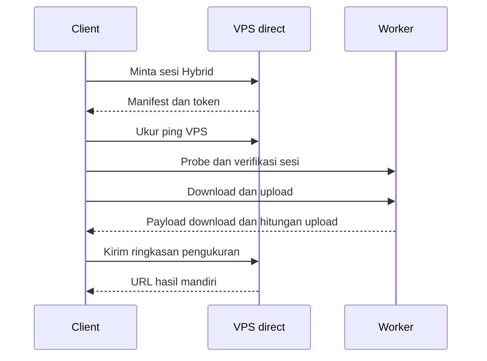

# SpeedtestServer dengan Cloudflare Workers Free

Rancangan implementasi dan verifikasi per 21 November 2026. Basis audit adalah `SpeedtestServer` `master@8912b07` dan `SpeedtestHost-Tester` `main@eab1697`. [Repo server][repo-server] · [Repo tester][repo-tester]

## 1. Keputusan untuk implementasi

**Bangun mode Hybrid untuk client milik sendiri.** VPS menerbitkan sesi, melayani ping langsung, dan menyimpan hasil. Worker memverifikasi otorisasi sesi secara lokal lalu menangani seluruh payload download dan upload. Pengguna tetap membuka `speedtest.example.com` dengan awan abu-abu. Client menerima URL transfer yang berbeda saat sesi dimulai. Pengukuran menghasilkan **tautan hasil di domain Anda**, misalnya `https://speedtest.example.com/r/<publicId>`.

**URL resmi Ookla mengikuti jalur Ookla.** Speedtest CLI resmi yang diuji memakai endpoint NetGauge TCP dan kanal UDP dari konfigurasi Ookla. Workers Free menyediakan endpoint HTTP(S)/WebSocket. Beta Spectrum untuk menerima TCP mentah ke Worker memerlukan zona Pro, Business, atau Enterprise yang memenuhi syarat. Pada paket Free, klien Ookla yang tidak dimodifikasi, hasil resmi Ookla, dan pemindahan payload NetGauge ke Worker tidak dapat dipenuhi sekaligus melalui perubahan DNS, sertifikat, atau konfigurasi server saja. Jika URL Ookla menjadi syarat, letakkan daemon pada host atau PoP yang disetujui Ookla dan memiliki kapasitas transfer langsung. VPS dengan IP yang ingin ditampilkan saat diping tetap bisa menjadi endpoint diagnostik tersendiri. [Ingress Workers][cf-protocols] · [Paket Spectrum][cf-spectrum] · [Onboarding Ookla][ookla-host]

### Penempatan hostname

| Nama contoh | DNS dan sertifikat | Tugas |
|---|---|---|
| `speedtest.example.com` | A dan AAAA yang tersedia menuju VPS, **DNS only**. VPS menyajikan sertifikat CA publik dengan SAN nama ini. | UI, sesi, latency HTTPS langsung, hasil. `ping speedtest.example.com` menuju IP VPS selama ICMP diizinkan. |
| `bandwidth.example.com` | **Workers Custom Domain**. Cloudflare mengelola DNS dan TLS edge. | `GET /v1/probe`, `GET /v1/download`, `POST /v1/upload`. |
| `<worker>.<akun>.workers.dev` | Nama bawaan Cloudflare. Bisa dipakai ketika seluruh record domain sendiri harus tetap abu-abu. | Opsi pilot untuk tiga endpoint Worker. Cloudflare menganjurkan Custom Domain untuk layanan produksi. |
| Endpoint NetGauge milik operator | DNS only ke host pengukuran yang sesuai, dengan listener dan sertifikat yang dibutuhkan client. | CLI kompatibel pada mode langsung, atau layanan resmi di host yang disetujui Ookla. IP, proses, dan port ditentukan oleh operator. |

DNS menyelesaikan **nama** ke alamat. Jika satu hostname abu-abu mengembalikan IP VPS, koneksi baru yang memakai nama itu juga menuju VPS. Menjadikannya oranye mengembalikan IP anycast Cloudflare. A/AAAA campuran, pergantian TTL, ECMP, atau pemasangan sertifikat yang sama tidak menjadikan DNS sebuah pemilih endpoint per fase pengukuran. Proxy HTTP standar juga tidak meneruskan ICMP Echo ke VPS. Pada proxy standar, port `8080` tercantum untuk HTTP, bukan HTTPS atau NetGauge TCP mentah, dan `5060` di luar daftarnya. Pakai HTTPS `443` untuk jalur Worker. [DNS proxy status][cf-dns] · [Custom Domains][cf-custom] · [workers.dev][cf-workersdev] · [Port proxy][cf-ports]

## 2. Alur Speedtest Ookla sampai hasil diterbitkan

| Tahap | Yang dilakukan client resmi | Bukti dan batas |
|---|---|---|
| 1. Discovery | CLI mengambil konfigurasi dan daftar server melalui HTTPS ke layanan Ookla. `--servers` menampilkan kandidat terdekat. `--server-id` dan `--host` memilih entri dari daftar server yang tersedia bagi CLI. | Opsi tersebut tidak mendefinisikan endpoint ping dan throughput secara terpisah. [Manual CLI][ookla-manual] · [Rekaman konfigurasi][external] |
| 2. Seleksi | CLI menghubungi `host:port` kandidat dan menilai respons latency. Setelah memilih server, CLI mengukur idle latency dan jitter pada endpoint pemenang. | Jumlah probe, koneksi, dan urutan bisa berubah antarversi dan konfigurasi. [Metodologi Ookla][ookla-selection] · [Peta sesi CLI][session-map] |
| 3. Handshake pengukuran | Run pada daemon rujukan dapat memulai handshake engine biner terenkripsi. Server TypeScript repo menangani NetGauge plaintext dan memperlihatkan fallback CLI dalam lab. Plaintext masih memakai socket TCP. Server juga punya transport TLS dan WebSocket untuk client yang memakainya. | TLS, enkripsi engine, dan perintah `HI/HELLO` adalah lapisan yang berbeda. Rekaman CLI 1.2.0.84 untuk transfer utama memperlihatkan NetGauge, tanpa request HTTP ke server pengukuran. [Kontrak protokol][protocol] · [Validasi CLI][official-api] |
| 4. Transfer | CLI mengatur koneksi paralel, meminta `DOWNLOAD`, mengirim payload `UPLOAD`, dan menjalankan probe saat link dibebani. Penghitungan menggabungkan waktu, byte, dan informasi terukur dari endpoint. | Mengalihkan file JPEG HTTP tidak mengalihkan transfer NetGauge. Ukuran dan jumlah koneksi adalah parameter pengukuran, bukan aturan routing. [Metodologi Ookla][ookla-method] · [Matriks fase][phase-map] |
| 5. Packet loss | Perintah `INITPLOSS/PLOSS` memakai TCP. Datagram `LOSS` dan balasan `RECV` memakai UDP. | Di implementasi ini keduanya perlu berbagi proses yang mencatat UDP dan identitas IP sumber yang konsisten. Percobaan `F8a` selesai dengan angka `0%` ketika pembaca statistik TCP dan penerima UDP berbeda. Angka itu tidak membuktikan UDP terukur dengan benar. [LossRegistry][loss-registry] · [Bukti F8a][f8a] |
| 6. Penerbitan | Setelah selesai, CLI mengirim hasil melalui HTTPS ke layanan hasil Ookla. Rekaman memperlihatkan `result.persisted: true` dan URL dari layanan ketika penerbitan diterima. CLI juga dapat selesai dengan `persisted: false` ketika layanan hasil tidak tersedia. | Exit code `0` membuktikan CLI selesai. URL resmi berasal dari layanan hasil. `OoklaServer.resultEndpointUrl` di konfigurasi server repo tidak mengendalikan penerbitan ini. [Audit alur eksternal][external] |

SpeedtestHost-Tester menguji dua hal berguna. Implementasi z.ai mengukur ping via `/ws` dan menjalankan download/upload legacy lewat HTTP. Implementasi Mistral juga menjalankan `HI`, `PING`, `DOWNLOAD`, dan `UPLOAD` langsung di TCP. Rekaman cross-validation z.ai menunjukkan dua run CLI resmi dengan log HTTP kosong, sementara tester legacy menghasilkan request HTTP. Gunakan z.ai untuk regression dan untuk PoC client dua endpoint. Gunakan perilaku CLI resmi yang direkam sebagai acuan terpisah. Bukti ini spesifik pada build dan transport yang diuji. Aplikasi resmi web/mobile pada versi lain memerlukan bukti sendiri. [Kode z.ai][tester-z] · [Kode Mistral][tester-m] · [Cross-validation][tester-cross]

Lab `F5-n22` melaporkan tiga pengukuran selesai saat seleksi dan idle ping dilayani backend A serta fase pengukuran, termasuk loaded latency dan UDP, dilayani backend B. Kedua backend menerima koneksi native melalui gateway lab. Bukti tersebut mendukung pemisahan backend yang memahami protokol. Ia belum membuktikan skenario VPS untuk semua ping dan Worker Free untuk semua byte throughput. Urutan koneksi pada log merupakan observasi lab. [Hasil F5-n22][diversion] · [Analisis DNS lab][dns-lab]

### Kapan sebuah hasil bisa disebut resmi Ookla

1. Gunakan proses [Speedtest Server Network][ookla-network]. Siapkan endpoint milik operator, daemon yang disyaratkan Ookla, port yang bisa dijangkau, dan tes host resmi. Ikuti persyaratan kapasitas, jaringan, hostname, TLS, dan IPv6 terkini dari portal operator. Panduan instalasi publik menyebut endpoint `host:8080` dan akses TCP/UDP `8080`. Panduan hosting lama juga menyebut `5060`. Portal operator menjadi acuan untuk penerimaan deployment. [Panduan instalasi][ookla-install] · [Panduan hosting][ookla-host] · [Host Tester resmi][ookla-tester]
2. Setelah host disetujui, lakukan tes dari client resmi dalam lingkup izin penggunaan. Pilih ID milik operator, cocokkan host/IP yang dilaporkan dengan endpoint yang benar, dan verifikasi lalu lintas pada host tersebut. Gunakan URL yang dikembalikan layanan ketika tes dipublikasikan. Pada build yang diuji, bukti JSON penerbitan adalah `result.persisted: true` dengan `result.url`. Simpan nilai sumber; data kecepatan format mesin menggunakan byte per detik dan dapat dikonversi ke Mbps dengan `× 8 / 1.000.000`. [Manual CLI][ookla-manual] · [Audit alur eksternal][external]
3. Untuk deployment ISP, embedding, otomatisasi komersial, atau redistribusi, pastikan haknya dari Ookla. Manual CLI 1.2.0.84 menyatakan pemakaian pribadi nonkomersial. Hak operator untuk menjalankan host dan hak memasukkan CLI dalam produk adalah dua hal yang perlu diverifikasi. Speedtest Custom menyediakan jalur embedding sesuai ketentuannya. [EULA CLI][ookla-eula] · [Ketentuan Ookla][ookla-terms] · [Ketentuan Speedtest Custom][ookla-custom]
4. Perlakukan tautan historis di `PUBLISHED_RESULT_URLS.md` sebagai bukti pipeline pengukuran pada lab. Repo menjelaskan bahwa byte pengukuran tetap di loopback dan bahwa eksperimen itu di luar sertifikasi host atau pengukuran jaringan sponsor yang tercantum. Untuk validasi berikutnya, gunakan daftar host resmi tanpa modifikasi, ID milik operator, dan ukuran yang berasal dari jalur aktual. Periksa hak distribusi executable vendor yang sudah tercatat di kedua repo sebelum memasukkannya ke rilis atau paket baru. [Batas bukti penerbitan][published] · [Executable server][repo-server] · [Manifest CLI vendor][vendor-manifest]

Mode Hybrid menerbitkan hasil dari route sendiri. Labelnya, metriknya, hostname tujuan, dan penerbitnya harus muncul pada halaman publik. Nilai hasil mengikuti jalur yang benar-benar diukur. Jika dibutuhkan hasil Ookla untuk jaringan origin, uji langsung endpoint resmi yang menyediakan kapasitas transfer itu.

## 3. Data yang dibagikan VPS dan Worker

Gunakan satu `sessionId` pada tingkat aplikasi. VPS dan Worker menyelesaikan handshake jaringan masing-masing. TLS menetapkan kunci traffic dan state untuk koneksi yang dibuat client. Sertifikat publik yang sama, atau salinan metadata handshake, tidak memutar ulang aliran TCP/TLS di endpoint lain. Skema sertifikat yang diusulkan membiarkan setiap hostname punya rantai kepercayaan yang dapat diperiksa secara independen. [TLS 1.3][tls-rfc] · [Cloudflare Origin CA][cf-origin-ca]

| Data | Lokasi dan pemakaian |
|---|---|
| Sertifikat publik, SAN, issuer, masa berlaku, fingerprint | Boleh disimpan sebagai metadata observabilitas. Normalnya client memvalidasi nama dan chain saat tersambung. VPS DNS-only memakai CA yang dipercaya browser. |
| Private key TLS, kunci traffic, ticket resumption, state TCP | Milik terminator koneksi masing-masing. Untuk status aplikasi cukup publikasikan metadata yang diperlukan. |
| ID sesi, versi metodologi, endpoint, fase, batas ukuran, expiry | VPS menerbitkan manifest dan token bertanda tangan. Client membawa token ke Worker. |
| Kunci tanda tangan sesi dan `kid` | VPS memegang signing key aplikasi. Worker memegang public verification key; kunci ini terpisah dari kunci TLS. Gunakan Ed25519 dengan JOSE/EdDSA yang sesuai standarnya. Siapkan key baru pada verifier sebelum digunakan untuk menerbitkan token. [Web Crypto Workers][cf-crypto] |
| Byte upload yang diterima, ukuran download yang diminta, status, edge colo | Worker mengembalikan bukti ringkas untuk dikorelasikan oleh client/VPS. Bukti upload dikeluarkan setelah body terbaca valid. Byte download yang benar-benar diterima dihitung di client. |
| RTT, jitter, durasi download/upload, hasil publik | Client mengukur dengan monotonic clock. VPS menyimpan hasil tervalidasi secara struktural dan menerbitkannya bila diminta pengguna. |

VPS bisa menggunakan ACME yang sudah tersedia di repo untuk hostname direct. Implementasi repo memakai HTTP-01, yang memerlukan challenge HTTP pada port publik `80`. Jika layanan hasil/portal menggunakan terminator yang sudah mengelola sertifikat, tetapkan satu pemilik proses renewal serta cara daemon canonical membaca sertifikat valid. Ketika pengguna mengakses origin secara DNS-only, sertifikat Cloudflare Origin CA tidak memenuhi trust browser publik. [TLS repo][server-tls] · [Cloudflare Origin CA][cf-origin-ca]

### Alur handshake aplikasi dan transfer



Client membuka koneksi HTTP(S) ke Worker dengan URL dari manifest. Worker memverifikasi token tanpa request per chunk ke VPS. Satu sesi dapat berjalan pada beberapa koneksi atau beberapa HTTP/2 dan HTTP/3 streams. VPS menerima JSON kecil. Syarat penghematan adalah jalur payload berakhir di Worker untuk upload dan dimulai di edge untuk download.

### Kontrak awal untuk agent

- Layanan VPS menerima `POST /api/v1/sessions`, mengembalikan `201` beserta manifest, dan membatasi pembuatan sesi. Gunakan `GET /api/v1/latency` atau endpoint `/speedtest/latency.txt` yang sudah tersedia jika dapat diakses via HTTPS langsung. `POST /api/v1/results` menyimpan sekali per sesi dan mengembalikan ID publik acak ketika user memilih membagikan hasil. Cegah duplikasi saat request diulang. [HttpApi.ts][http-api]
- Token berisi `ver`, `iss`, `aud`, `sub` atau `sid`, `iat`, `exp`, `jti`, fase yang diizinkan, dan cap byte per request. Header JOSE menyertakan `kid`. Cocokkan algoritme, issuer, audience, versi, dan target operasi pada verifier. Gunakan TTL contoh lima menit untuk pilot dan hitung ulang bila target pengukuran memang memerlukan lebih.
- Untuk pengukuran yang hanya akan dibaca penggunanya, hitungan upload di respons, session ID, dan log korelasi cukup untuk MVP. Jika hasil dipakai sebagai laporan yang harus dapat diaudit, tambahkan receipt upload yang ditandatangani dengan kunci aplikasi Worker tersendiri. Sertakan `sid`, fase, `chunkId`, byte, dan timestamp. Verifikasi receipt dan deduplikasi di VPS. Receipt menunjukkan byte yang diterima Worker. Waktu yang dilaporkan client dan byte yang benar-benar diterima browser tetap merupakan pengamatan client.
- Pakai `Authorization: Bearer`, HTTPS, dan CORS untuk daftar origin portal. Untuk browser, dukung `OPTIONS` dan antisipasi request tambahan karena preflight. Atur `Timing-Allow-Origin` bila memakai Resource Timing lintas origin serta `Access-Control-Expose-Headers` untuk header pengukuran custom. Origin layar hasil dan issuer sesi ditetapkan dari konfigurasi operator.
- Hapus token dari URL, log, dan halaman hasil. Untuk hasil publik, tampilkan rute pengukuran, putaran metodologi, dan timestamp. Simpan alamat jaringan klien hanya bila dibutuhkan operasional. Rate limit boleh menggunakan identitas yang sesuai konteks dan tetap dipisahkan dari URL publik.

Contoh bentuk respons sesi. Semua hostname dan nilai di bawah adalah placeholder.

```json
{
  "schemaVersion": 1,
  "sessionId": "01800000-0000-7000-8000-000000000000",
  "mode": "hybrid",
  "methodVersion": "hybrid-v1",
  "expiresAt": "2026-11-21T04:05:00Z",
  "vpsLatencyUrl": "https://speedtest.example.com/api/v1/latency",
  "edgeProbeUrl": "https://bandwidth.example.com/v1/probe",
  "downloadUrl": "https://bandwidth.example.com/v1/download",
  "uploadUrl": "https://bandwidth.example.com/v1/upload",
  "resultsUrl": "https://speedtest.example.com/api/v1/results",
  "maxBytesPerRequest": 16777216,
  "token": "<short-lived-signed-token>"
}
```

## 4. Opsi offload yang bisa dipilih

| Desain | Syarat | Hasil penilaian |
|---|---|---|
| **Dua endpoint dari manifest** | Client sendiri, VPS DNS-only dan hostname Worker terpisah. | Pilihan utama. Ping mengarah ke VPS dan transfer langsung ke edge. Peran endpoint dapat diuji berdasarkan hostname dan counter byte. |
| **URL awal di VPS lalu redirect GET** | Client HTTP mengikuti redirect ke URL edge yang sudah ditetapkan. | Bisa dipakai untuk download yang kontraknya mendukung redirect. VPS hanya menjawab respons kecil. Untuk upload gunakan manifest **sebelum** mengirim body, agar tahap pertama sama sekali tidak membawa payload besar ke VPS. Perhatikan otorisasi lintas origin. [Fetch Standard][fetch-std] |
| **Awan oranye dan Worker Routes per path** | Client memakai HTTP(S) atau WebSocket. Path download/upload masuk Worker, path ringan bisa menuju origin. | Layak untuk compatibility adapter HTTP lama. Ping terminal ke hostname itu melihat IP Cloudflare. Ping HTTP yang diteruskan ikut mengukur jalur edge–origin. Terapkan aturan host/SAN dan TLS origin yang sesuai saat meneruskan path. [Worker Routes][cf-routes] · [HttpApi.ts][http-api] |
| **Provider hostname `workers.dev`** | Domain sendiri harus seluruhnya DNS-only. | Jalan tercepat untuk menguji pemisahan. Client mengambil URL provider dari manifest. Gunakan nama sendiri yang mengarah langsung ke Worker ketika menginginkan kontrol hostname produksi. [workers.dev][cf-workersdev] |
| **Workers Static Assets** | Handler download melayani file sintetis build-time via `env.ASSETS.fetch()`. | Jalur optimasi jika CPU saat streaming dinamis menjadi bottleneck. Pilih ukuran utuh, misalnya 1, 4, dan 16 MiB. Batas per file 25 MiB. Static Assets Worker saat ini mengembalikan file utuh terhadap `Range`. Untuk file berotorisasi, pastikan semua path langsung melewati Worker atau ditolak. `run_worker_first` tetap memakai kuota Worker. [Assets binding][cf-assets] · [Billing dan batas Assets][cf-assets-billing] |
| **WebSocket yang diakhiri di Worker** | Client sendiri memakai `wss://` dan kontrak framing yang disepakati. | Opsional jika HTTP per chunk menjadi hambatan. Worker bisa membuat payload di edge, tetapi client perlu mengatur backpressure, ukuran frame, lalu menguji CPU dan kestabilan. Worker yang sekadar meneruskan WS ke VPS masih membebani VPS. [WebSocket Workers][cf-websockets] |
| **Cloudflare Tunnel** | Untuk layanan TCP publik non-HTTP, mode umum membutuhkan client Cloudflare yang sesuai. | Dapat menghubungkan control API atau lingkungan pengujian yang memang dikelola operator. Tunnel ke VPS meneruskan byte ke VPS. Tunnel tidak menambahkan ingress NetGauge TCP/UDP publik ke Workers Free. [Protokol Tunnel][cf-tunnel] |
| **Spectrum atau Cloudflare Containers** | TCP Worker-origin beta membutuhkan zona yang memenuhi paket yang disyaratkan. Containers termasuk produk yang ditagih. | Di luar batas Free. Menggunakan keduanya pun tidak membuat hostname edge menampilkan IP VPS saat diping atau memberikan persetujuan host Ookla. [Paket Spectrum][cf-spectrum] · [Pricing Developer Platform][cf-pricing] |
| **Cache CDN VPS atau R2** | Cache hit bisa mengurangi byte origin untuk unduhan yang bisa dicache. R2 merupakan layanan storage dengan kuota dan penagihan pemakaian. | Repo saat ini mengirim `Cache-Control: no-store` pada HTTP legacy. Cache miss mengambil dari origin dan cache bukan penerima upload. R2 bukan dependensi rancangan Free ini. [HttpApi.ts][http-api] · [Harga R2][cf-r2] · [Ketentuan Cloudflare CDN][cf-cdn-terms] |

Mengganti DNS antar fase, mengandalkan ECMP, membuka dua A/AAAA dengan harapan client memilih per operasi, atau berbagi private key TLS tidak memberi routing yang dibutuhkan. Dengan client sendiri, manifest memberi pemilihan tujuan yang deterministik tanpa perlu menebak urutan request. Untuk UI HTTP mandiri, komponen MIT `@cloudflare/speedtest` dapat menjadi referensi metodologi, ramp-up, dan pengaturan endpoint. Pertahankan endpoint pengukuran yang dikendalikan operator ketika produk diluncurkan. [Kode Cloudflare Speedtest][cf-speed-client]

## 5. Batas Free dan penghematan bandwidth

| Batas atau perilaku | Implikasi implementasi |
|---|---|
| **100.000 invokasi Worker per akun per hari**, reset 00.00 UTC atau 07.00 WIB | Hitung semua GET, POST, OPTIONS, probe, retry, serta pemakaian Worker lain pada akun. Saat habis, Cloudflare dapat mengembalikan Error 1027. Jalur Assets yang harus memanggil Worker dapat mengembalikan HTTP 429. |
| **10 ms CPU per request** pada Workers Free, **128 MB memori per isolate** | Ukur CPU produksi dengan Analytics. Streaming memisahkan tunggu jaringan dari kerja JS, tetapi setiap verifikasi, iterasi, dan generasi payload tetap memakai CPU. Hindari hashing seluruh payload pada MVP, buffer penuh, atau random buffer besar per request. |
| **100 MB request body** pada zona Cloudflare Free | Mulai dari chunk 4–16 MiB per request upload. Validasi `Content-Length` bila hadir dan hitung byte yang benar-benar masuk saat streaming. Atur juga batas aplikasi dan batas jumlah request sesi. |
| Cloudflare tidak menetapkan cap ukuran response body Worker pada tabel limit HTTP | Cap milik aplikasi tetap diperlukan. Throughput sesungguhnya bergantung pada CPU, PoP, ISP, perangkat, dan protokol HTTP. Jangan menarik kesimpulan angka Gbps dari besarnya limit platform. |

Sumber limit dan perilaku kegagalan. [Workers Limits][cf-limits] · [Workers Pricing][cf-pricing] · [Assets Billing][cf-assets-billing] · [Worker Analytics][cf-analytics]

**Hitung kuota sebelum pilot publik.** Pada 1 Gbps selama enam detik, satu arah membawa sekitar 750 MB. Dengan chunk 16 MiB dibutuhkan setidaknya 45 request data per arah. Bila satu run memakai sekitar 110 invokasi setelah probe dan overhead, 80.000 invokasi yang dicadangkan untuk tes cukup untuk sekitar **727 run per hari**, sebelum memperhitungkan pemakaian lain yang belum masuk angka tersebut. Nyalakan batas admission berdasarkan invokasi terukur dan beri ruang untuk CORS, retry, dan anomali. Untuk mengukur link yang lebih cepat, naikkan ukuran atau paralelisme hanya setelah CPU, cap body, dan jumlah invokasi lolos uji. Ketika cap menghentikan saturasi, simpan fase sebagai terbatas dan tampilkan kondisi tersebut.

Batas penerbitan token di VPS dan rate limiter per PoP menurunkan risiko satu sesi menyedot kuota. Token stateless dengan cap per request tidak membatasi jumlah pemakaian ulang secara global. Untuk pilot, gunakan sesi pendek, pembatasan penerbitan, batas request per identitas bila tersedia, dan pembatasan teknis di handler. Jika produksi membutuhkan batas total yang ketat, tambahkan reservasi kecil yang atomik per `sid + fase + chunkId` di control API VPS atau gunakan store konsisten yang telah diverifikasi termasuk Free. Payload tetap langsung ke edge. Hitung seluruh biaya invokasi skema itu sebelum memilihnya. [Rate Limiting Worker][cf-rate-limit] · [Self-Serve Agreement][cf-terms]

**Periksa ketentuan Cloudflare sebelum membuka tes besar ke publik.** Ketentuan khusus CDN membatasi penggunaan proxy CDN Free untuk file besar dan menyebut layanan yang memenuhi syarat. Dokumentasi biaya dan limit Workers Free tidak memberi persetujuan eksplisit untuk setiap pola layanan speedtest publik ber-volume tinggi. Jalur yang diusulkan adalah aplikasi Worker yang membuat atau menyajikan payload sintetis di edge, dengan admission dan cap yang jelas. Untuk rollout besar, konfirmasi penerapan ketentuan pada pola penggunaan itu. Periksa ulang jika beralih ke cache CDN origin atau storage dengan penagihan. Ketentuan Self-Serve melarang pengelakan kuota. [Cloudflare CDN Terms][cf-cdn-terms] · [Developer Platform Terms][cf-dev-terms] · [Self-Serve Agreement][cf-terms] · [Penjelasan perubahan ketentuan][cf-tos-blog]

## 6. Langkah implementasi

### Fase A — Bekukan baseline dan buktikan rute

1. Kerjakan di branch fitur. Ambil baseline dari commit audit. Bangun TypeScript canonical di `reverse-engineered/typescript` dan jalankan suite repo. Simpan bukti bahwa TCP/TLS/WebSocket/UDP dan HTTP legacy dapat diuji melalui entry point biasa. Pakai build lokal yang sah, tanpa mengandalkan executable vendor yang tersalin ke repo. [Kode canonical][repo-server] · [Handoff baseline][handoff]
2. Untuk lab dua tujuan, buat client kecil atau mode opsional di tester z.ai yang menerima base URL terpisah untuk latency dan throughput. Default tester untuk satu host dijadikan regression gate. Pada mode Hybrid gunakan URL penuh HTTPS. Kode tester yang ada membuat `base = http://<host>:<port>` untuk legacy sehingga mengganti hostname saja belum cukup untuk Worker HTTPS. [Kode z.ai][tester-z]
3. Gunakan dua port localhost sebagai batas jaringan antara control service dan Worker runtime. Jalankan POST sesi, satu download dan upload dengan ukuran diketahui, lalu POST hasil. Cocokkan daftar request dan byte pada service VPS serta counter transfer edge sebelum melakukan pengujian Cloudflare.

### Fase B — Implementasikan control service pada VPS

1. Buat service kecil pada HTTPS `443` di hostname DNS-only. Port NetGauge dikelola oleh daemon canonical sesuai mode penggunaan. Pisahkan service HTTP Hybrid dari kode wire protocol agar feature dapat dimatikan tanpa merutekan payload ke daemon.
2. Implementasikan endpoint dari §3. Terbitkan signing key aplikasi menggunakan penyimpanan rahasia yang sudah dipakai operator. Worker hanya perlu key publik. Simpan metadata sesi dan hasil berukuran kecil dengan operasi idempoten. Bila belum ada penyimpanan di proyek, mulai dari penyimpanan lokal yang mendukung operasi atomik dan restart, misalnya SQLite pada control service.
3. Buat hasil URL sendiri dengan nama penerbit, mode, hostname VPS dan edge, metodologi, waktu, arah, byte, Mbps, latency yang relevan, dan alasan jika fase tidak tersedia. Hasil yang diulang dengan `sid` sama mengembalikan ID yang sama. Tautan publik hanya dibuat dengan tindakan berbagi atau kebijakan publikasi yang dipilih operator.

### Fase C — Implementasikan Worker Free dengan entry point terpisah

Rancangan hibrida lama memberi contoh, sedangkan commit canonical belum memuat Worker yang siap deploy. Tempatkan kode baru, misalnya di `hybrid/edge`. Pilih runtime API `fetch`, Web Streams, dan Web Crypto. `ServerCore` saat ini membuka listener Node dan UDP, sementara `HttpApi` menggunakan request/response Node. Gunakan ulang aturan hitung byte dan spesifikasi endpoint seperlunya tanpa memindahkan lifecycle daemon. [Rancangan hibrida lama][old-hybrid] · [ServerCore.ts][server-core] · [HttpApi.ts][http-api] · [Web Streams Workers][cf-streams]

| Endpoint | Kontrak minimum |
|---|---|
| `GET /v1/probe` | Respons kecil `204` tanpa cache. Cocok untuk latency HTTPS ke edge. Sertakan colo yang teramati dalam header diagnostik yang diizinkan CORS bila tersedia. |
| `GET /v1/download?bytes=N` | Setelah autentikasi dan batas `N` lolos, stream tepat `N` byte sintetis. Gunakan data yang sulit dikompresi dan `Cache-Control: no-store, no-transform`. Pakai `FixedLengthStream` bila header ukuran diperlukan. Untuk assets, gunakan panjang file yang diketahui dan uji header aktual. Akhiri stream saat client membatalkan. |
| `POST /v1/upload` | Validasi metode, tipe yang diharapkan, token, dan ukuran. Baca body sebagai stream, jumlahkan byte, dan lepas tiap chunk. Balas byte yang sungguh diterima setelah body selesai. Tolak yang melebihi cap. Catat disconnect/reset sebagai transfer gagal meskipun respons error tidak sampai ke client. |
| `OPTIONS` | Respons CORS ringan untuk origin portal yang diizinkan dengan preflight cache yang sesuai. Metode lain tidak boleh memulai transfer. |

Atur output binary sebagai `application/octet-stream`. Bypass cache browser pada endpoint ukuran dan latency. `Cache-Control: no-transform` membantu menjaga byte tetap representatif, tetapi tetap verifikasi `Content-Encoding` dari klien nyata. `FixedLengthStream` memberi runtime informasi panjang. Header `Content-Length` yang Anda pasang sendiri pada response stream biasa diabaikan runtime. [Response Workers][cf-response] · [Aturan kompresi][cf-compression]

Konfigurasi acuan. Gunakan versi Wrangler/workerd yang mendukung compatibility date yang dipilih. Sejak compatibility date `2026-11-17`, `request.signal` dapat menerima abort/disconnect secara default. Uji juga cancel di reader/writer. Untuk pilot `workers.dev`, aktifkan `workers_dev` dan hilangkan route Custom Domain. [Konfigurasi Wrangler][cf-wrangler] · [Worker routing][cf-custom] · [Request.signal][cf-abort]

```json
{
  "name": "speedtest-bandwidth",
  "main": "src/index.ts",
  "compatibility_date": "2026-11-21",
  "routes": [
    { "pattern": "bandwidth.example.com", "custom_domain": true }
  ],
  "workers_dev": false,
  "preview_urls": false
}
```

Mulai dengan streaming yang batasnya kecil. Jika CPU Free berulang kali habis saat membuat download, uji fixed assets dan forwarding stream internal Worker ke client. Jika upload yang mengenai CPU, kecilkan chunk atau overhead per chunk, lalu hitung ulang kuota request. Hindari pemanggilan host origin dari handler bulk. Untuk proof of concept legacy, adapter bisa memberikan `HEAD` untuk ukuran JPEG dan `size=N` setelah POST selesai, mengikuti kontrak `HttpApi` yang ada. [Kontrak HTTP repo][http-api] · [Workers Limits][cf-limits]

### Fase D — Ukur dan terbitkan hasil mandiri

1. Sesudah sesi dibuat, hangatkan koneksi secukupnya, ukur idle latency VPS dan edge dengan probe kecil, lalu lakukan download dan upload secara berurutan. Jalankan probe edge berkala saat masing-masing transfer. Jika juga menampilkan ping VPS selama tes edge, beri label **latency VPS saat tes edge berjalan**.
2. Gunakan monotonic clock dan jumlahkan byte nyata pada rentang waktu pengukuran **yang sama**. Untuk download, baca stream sampai selesai atau catat secara eksplisit byte valid hingga pembatalan. Untuk upload, gunakan byte yang dikonfirmasi server. Hindari menjumlahkan bandwidth beberapa request yang intervalnya berbeda. Rumus agregasi adalah `8 × total byte yang dihitung / durasi detik / 1.000.000`. Catat ukuran chunk, jumlah stream, durasi, dan kondisi saturasi.
3. Browser mengukur RTT aplikasi lewat HTTPS. Persentase packet loss UDP dapat diisi oleh client native dengan probe UDP ke VPS atau mekanisme browser khusus yang dirancang mengukur loss pada jalurnya sendiri. Jika browser hanya memakai fetch atau WebSocket, nyatakan packet loss UDP tidak tersedia. Retransmisi TCP/HTTP terobservasi berbeda dari datagram loss.
4. Ketika Worker kehabisan kuota, timeout, atau abort, hentikan fase itu dan tandai hasil parsial. Mode VPS-only boleh ditawarkan sebagai tes baru yang dipilih pengguna dan dikendalikan operator, dengan metrik serta labelnya sendiri. Skema ini menjaga VPS dari lonjakan fallback massal.

### Pertukaran data dari Worker kembali ke VPS

Jalur awal mengirim ringkasan melalui client. Worker bisa menandatangani receipt agar VPS dapat memverifikasi bahwa hitungan upload berasal dari endpoint yang mengukur body. Bila diperlukan untuk audit pusat, tambah callback Worker → VPS yang terautentikasi dan mengirim **ringkasan kecil** per sesi atau per batch. Callback perlu timestamp, identitas Worker, deduplikasi, dan penanganan kegagalan yang terlihat. Gunakan kunci aplikasi khusus, URL control yang tetap, serta TLS publik yang valid. Penerbitan token dan distribusi public key menyediakan jalur VPS → Worker. Kedua sisi dapat berkorelasi lewat `sid` tanpa menempatkan panggilan kontrol dalam hot path setiap blok data.

## 7. Gate verifikasi dan kriteria selesai

| Gate | Cara membuktikan | Kondisi lulus |
|---|---|---|
| **DNS dan TLS** | Periksa A/AAAA kedua hostname. Uji dengan klien TLS yang memverifikasi nama dan chain. Uji ICMP v4/v6 sejauh diizinkan. | Host ping mengembalikan alamat VPS yang dimaksud. Host Worker disajikan Cloudflare. Sertifikat publik kedua host lolos verifikasi independen. |
| **Handshake dan token** | Uji token valid, hilang, diubah, kedaluwarsa, `kid` belum dikenal, audience salah, dan operasi yang di luar scope. Uji rotasi key baru/lama dan replay sesuai kebijakan. | Worker memberi transfer hanya pada token dan operasi yang sah. Uji positif tidak memerlukan request verifikasi ke VPS untuk setiap body. |
| **Atribusi bandwidth** | Mulai dengan transfer ukuran pasti. Catat body yang diterima client, hitungan upload Worker, daftar request VPS, dan TX/RX interface VPS dalam jendela tes yang terisolasi. Gunakan filter atau baseline untuk mengabaikan traffic pihak lain. Bandingkan terhadap tes langsung. | Download/uplink selaras dengan hitungan dalam toleransi dokumentasi. VPS melihat traffic kontrol/probe saja. Bukti menyertakan byte VPS dan byte edge per fase. Ketiadaan payload bulk di VPS merupakan syarat, termasuk saat Worker gagal. |
| **Kebenaran pengukuran** | Uji IPv4/IPv6 dan beberapa kualitas link, batas buatan di lab, koneksi cepat, putus tengah aliran, CORS, cache browser, dan kompresi. Uji edge dari jaringan pelanggan yang mewakili pengguna sebenarnya. | Byte dihitung sekali dan sesuai dengan durasi. Cache browser dan kompresi tidak mengubah ukuran tes. Latency loaded ditautkan pada jalur yang tepat. Pengukuran parsial dan loss yang tidak tersedia terlihat pada hasil. |
| **Cloudflare Free** | Cek status paket, Analytics produksi, CPU dan invokasi p95, pemakaian akun harian, serta simulasi 413, 429, quota exhaustion atau timeout pada client. Pakai deploy uji yang memang diotorisasi. | Tidak ada dependensi produk berbayar pada arsitektur. Porsi kuota aman berdasarkan invokasi nyata. Tidak ada retry tak terbatas atau fallback massal ke VPS. Target throughput ditetapkan sesudah pengukuran PoP nyata. |
| **Hasil yang bisa dibagikan** | Jalankan tes, simpan hasil, ulang pengiriman hasil, dan buka URL dari perangkat kedua. Untuk jalur resmi terpisah, tes host yang benar-benar disetujui Ookla, periksa host/IP aktual dan respons persistensi. | URL mandiri memiliki penerbit serta tujuan tes yang benar dan konsisten saat retry. Bila dibutuhkan URL Ookla, URL diperoleh dari layanan resmi pada tes sah atas host yang tepat. |
| **Regression canonical** | `npm run build` serta `npm test -- --runInBand` di TypeScript canonical, smoke tester z.ai, NetGauge TCP, TLS, UDP dengan paket yang sengaja dilewatkan, dan HTTP legacy. | Perilaku baseline lulus. Uji UDP menunjukkan counter berubah sesuai paket yang diterima dan paket hilang menghasilkan pembacaan yang sesuai. |

Perintah contoh untuk DNS dan verifikasi sertifikat. Ganti nama dengan hostname uji milik operator.

```bash
dig +short A speedtest.example.com
dig +short AAAA speedtest.example.com
dig +short A bandwidth.example.com
ping -c 3 speedtest.example.com
openssl s_client -connect speedtest.example.com:443 \
  -servername speedtest.example.com -verify_hostname speedtest.example.com \
  -verify_return_error </dev/null
openssl s_client -connect bandwidth.example.com:443 \
  -servername bandwidth.example.com -verify_hostname bandwidth.example.com \
  -verify_return_error </dev/null
```

Siapkan rollout kecil melalui konfigurasi URL discovery. Aktifkan Hybrid untuk kelompok uji biasa atas permintaan operator, periksa angka sebelum memperbesar cakupannya, dan matikan penerbitan sesi Hybrid bila kegagalan meningkat atau kuota habis. Simpan hasil lama dengan metode pengukurannya. Untuk setiap uji yang gagal, rekam status, transport, fase, arah, dan sisi penyebab agar retry atau rollback terarah.

### Bukti uji yang sudah tersedia

- Pada commit `8912b07`, build TypeScript dan **160/160** tes lulus pada audit lokal. Tester z.ai menghasilkan **10/10** di loopback. Log menunjukkan NetGauge melalui WebSocket untuk ping dan HTTP untuk download/upload. Tes loopback menggunakan konfigurasi pengembangan dan tidak memverifikasi kesiapan TLS produksi. [Handoff baseline][handoff] · [Perbandingan Host Tester][host-comparison]
- Proof of concept lokal dengan Miniflare **4.20260730.0 / workerd** memakai control service Node pada port terpisah. Control menandatangani sesi Ed25519. Worker memverifikasi dengan public key, mengirim **8.388.608 byte** lewat `FixedLengthStream`, dan mengonfirmasi **8.388.608 byte** upload yang dibacanya. Log control berisi `/session` dengan body request 0 byte dan `/result` dengan body 92 byte. Token rusak dan kedaluwarsa ditolak dengan `401`. Uji ukuran melebihi cap per request mendapat `413`. Ini adalah bukti pemisahan body dan kompatibilitas API di runtime lokal, dengan payload sintetis.
- Deploy Free sebenarnya, performa para ISP/PoP, kuota dan CPU produksi, ketentuan untuk rollout publik ber-volume besar, serta persetujuan host Ookla masih perlu diverifikasi oleh operator. Bukti localhost tidak menyediakan hasil resmi Ookla atau benchmark jaringan publik. Perubahan yang diselesaikan pada tahap ini adalah dokumen analisis dan eksperimen lokal, dengan dua commit repo sebagai rujukan.

## Referensi

- **Kode dan bukti repo.** [SpeedtestServer][repo-server] · [SpeedtestHost-Tester][repo-tester] · [Arsitektur hibrida lama][old-hybrid] · [Audit alur eksternal][external] · [Kontrak protokol][protocol] · [Matriks fase][phase-map]
- **Cloudflare.** [DNS proxy][cf-dns] · [Workers routing][cf-custom] · [Workers Limits][cf-limits] · [Plan Spectrum][cf-spectrum] · [Developer Platform Terms][cf-dev-terms] · [CDN Terms][cf-cdn-terms]
- **Ookla.** [Speedtest Server Network][ookla-network] · [Panduan host][ookla-host] · [Panduan pemasangan dan pengajuan][ookla-install] · [Manual CLI 1.2.0.84][ookla-manual] · [EULA][ookla-eula] · [Ketentuan][ookla-terms]

[repo-server]: https://github.com/smahud/SpeedtestServer/tree/8912b0754510dd0c61b0e1b5def7c5b11d05dde9
[repo-tester]: https://github.com/smahud/SpeedtestHost-Tester/tree/eab16976a4dbf48f36b0d81da5413cf2860e3cfa
[old-hybrid]: https://github.com/smahud/SpeedtestServer/blob/8912b0754510dd0c61b0e1b5def7c5b11d05dde9/speedtest-cli_analysis/hybrid-architecture/README.md
[server-core]: https://github.com/smahud/SpeedtestServer/blob/8912b0754510dd0c61b0e1b5def7c5b11d05dde9/reverse-engineered/typescript/src/server/ServerCore.ts#L295
[http-api]: https://github.com/smahud/SpeedtestServer/blob/8912b0754510dd0c61b0e1b5def7c5b11d05dde9/reverse-engineered/typescript/src/server/HttpApi.ts
[loss-registry]: https://github.com/smahud/SpeedtestServer/blob/8912b0754510dd0c61b0e1b5def7c5b11d05dde9/reverse-engineered/typescript/src/server/NetGaugeEngine.ts#L197
[server-tls]: https://github.com/smahud/SpeedtestServer/blob/8912b0754510dd0c61b0e1b5def7c5b11d05dde9/validation/TLS_CERTIFICATES.md#L70
[external]: https://github.com/smahud/SpeedtestServer/blob/8912b0754510dd0c61b0e1b5def7c5b11d05dde9/validation/EXTERNAL_FLOWS.md#L13
[protocol]: https://github.com/smahud/SpeedtestServer/blob/8912b0754510dd0c61b0e1b5def7c5b11d05dde9/validation/PROTOCOL_CONTRACT.md
[phase-map]: https://github.com/smahud/SpeedtestServer/blob/8912b0754510dd0c61b0e1b5def7c5b11d05dde9/validation/diversion-lab/reports/MEASUREMENT_PHASE_MATRIX.md
[session-map]: https://github.com/smahud/SpeedtestServer/blob/8912b0754510dd0c61b0e1b5def7c5b11d05dde9/validation/diversion-lab/reports/NETGAUGE_SESSION_MAP.md
[official-api]: https://github.com/smahud/SpeedtestServer/blob/8912b0754510dd0c61b0e1b5def7c5b11d05dde9/validation/OFFICIAL_CLI_RESULTS.md#L35
[f8a]: https://github.com/smahud/SpeedtestServer/blob/8912b0754510dd0c61b0e1b5def7c5b11d05dde9/validation/diversion-lab/evidence/f8a/analysis.txt#L44
[diversion]: https://github.com/smahud/SpeedtestServer/blob/8912b0754510dd0c61b0e1b5def7c5b11d05dde9/validation/diversion-lab/reports/BACKEND_DIVERSION_RESULTS.md#L84
[dns-lab]: https://github.com/smahud/SpeedtestServer/blob/8912b0754510dd0c61b0e1b5def7c5b11d05dde9/validation/diversion-lab/reports/DNS_AND_IP_BEHAVIOR.md
[published]: https://github.com/smahud/SpeedtestServer/blob/8912b0754510dd0c61b0e1b5def7c5b11d05dde9/validation/PUBLISHED_RESULT_URLS.md#L179
[handoff]: https://github.com/smahud/SpeedtestServer/blob/8912b0754510dd0c61b0e1b5def7c5b11d05dde9/validation/HANDOFF.md
[host-comparison]: https://github.com/smahud/SpeedtestServer/blob/8912b0754510dd0c61b0e1b5def7c5b11d05dde9/validation/HOST_TESTER_COMPARISON.md
[tester-z]: https://github.com/smahud/SpeedtestHost-Tester/blob/eab16976a4dbf48f36b0d81da5413cf2860e3cfa/z.ai/cli/speedtest-host-tester.mjs#L442
[tester-m]: https://github.com/smahud/SpeedtestHost-Tester/blob/eab16976a4dbf48f36b0d81da5413cf2860e3cfa/mistral.ai/cli/ookla_host_tester.py#L485
[tester-cross]: https://github.com/smahud/SpeedtestHost-Tester/blob/eab16976a4dbf48f36b0d81da5413cf2860e3cfa/z.ai/cross-validation/README.md#L73
[vendor-manifest]: https://github.com/smahud/SpeedtestHost-Tester/blob/eab16976a4dbf48f36b0d81da5413cf2860e3cfa/arena.ai/speedtest-cli/CLI_MANIFEST.md
[ookla-manual]: https://github.com/smahud/SpeedtestHost-Tester/blob/eab16976a4dbf48f36b0d81da5413cf2860e3cfa/arena.ai/speedtest-cli/speedtest.md
[ookla-network]: https://www.ookla.com/network
[ookla-host]: https://speedtest.zendesk.com/hc/en-us/articles/203845650-How-can-I-host-a-server-on-Speedtest-net
[ookla-install]: https://zdtm.my.site.com/ooklasupport/s/article/how-to-install-submit-server
[ookla-tester]: https://www.speedtest.net/host-tester
[ookla-selection]: https://s1.ooklaserver.org/help/guides/how-does-speedtest-select-a-server
[ookla-method]: https://ooklaserver.org/help/guides/how-does-speedtest-measure-my-network-speeds
[ookla-eula]: https://www.speedtest.net/about/eula
[ookla-terms]: https://ooklaserver.org/about/terms
[ookla-custom]: https://account.speedtestcustom.com/terms-conditions
[cf-dns]: https://developers.cloudflare.com/dns/proxy-status/
[cf-custom]: https://developers.cloudflare.com/workers/configuration/routing/custom-domains/
[cf-routes]: https://developers.cloudflare.com/workers/configuration/routing/routes/
[cf-workersdev]: https://developers.cloudflare.com/workers/configuration/routing/workers-dev/
[cf-ports]: https://developers.cloudflare.com/fundamentals/reference/network-ports/
[cf-protocols]: https://developers.cloudflare.com/workers/reference/protocols/
[cf-spectrum]: https://developers.cloudflare.com/spectrum/protocols-per-plan/
[cf-limits]: https://developers.cloudflare.com/workers/platform/limits/
[cf-pricing]: https://developers.cloudflare.com/workers/platform/pricing/
[cf-tunnel]: https://developers.cloudflare.com/cloudflare-one/networks/connectors/cloudflare-tunnel/routing-to-tunnel/protocols/
[cf-websockets]: https://developers.cloudflare.com/workers/runtime-apis/websockets/
[cf-origin-ca]: https://developers.cloudflare.com/ssl/origin-configuration/origin-ca/troubleshooting/
[cf-crypto]: https://developers.cloudflare.com/workers/runtime-apis/web-crypto/
[cf-streams]: https://developers.cloudflare.com/workers/runtime-apis/streams/
[cf-response]: https://developers.cloudflare.com/workers/runtime-apis/response/#set-the-content-length-header
[cf-compression]: https://developers.cloudflare.com/rules/compression-rules/
[cf-wrangler]: https://developers.cloudflare.com/workers/wrangler/configuration/
[cf-abort]: https://developers.cloudflare.com/changelog/post/2026-11-02-request-signal-default/
[cf-assets]: https://developers.cloudflare.com/workers/static-assets/binding/
[cf-assets-billing]: https://developers.cloudflare.com/workers/static-assets/billing-and-limitations/
[cf-analytics]: https://developers.cloudflare.com/workers/observability/metrics-and-analytics/
[cf-rate-limit]: https://developers.cloudflare.com/workers/runtime-apis/bindings/rate-limit/
[cf-r2]: https://developers.cloudflare.com/r2/pricing/
[cf-speed-client]: https://github.com/cloudflare/speedtest
[cf-cdn-terms]: https://www.cloudflare.com/service-specific-terms-application-services/
[cf-dev-terms]: https://www.cloudflare.com/service-specific-terms-developer-platform/
[cf-terms]: https://www.cloudflare.com/terms/
[cf-tos-blog]: https://blog.cloudflare.com/updated-tos/
[tls-rfc]: https://datatracker.ietf.org/doc/html/rfc8446
[fetch-std]: https://fetch.spec.whatwg.org/#http-redirect-fetch
